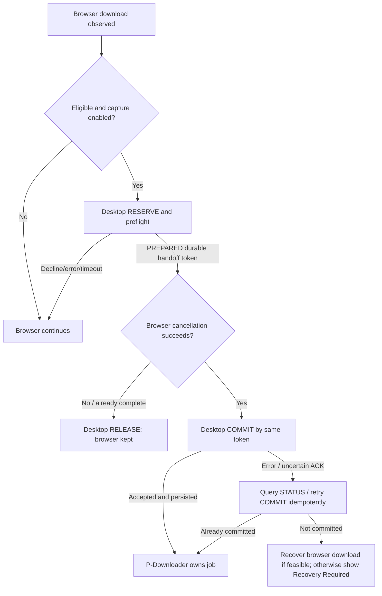
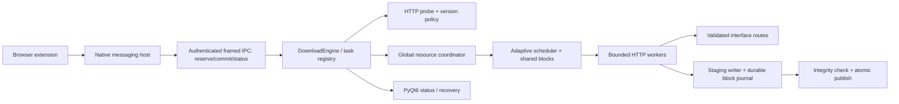

# P-Downloader: IDM-Grade Reliability, Adaptive Speed, and Browser Handoff Implementation Plan

> **For agentic workers:** REQUIRED SUB-SKILL: Use superpowers:subagent-driven-development (recommended) or superpowers:executing-plans to implement this plan task-by-task. Steps use checkbox (`- [ ]`) syntax for tracking.
>
> **Status:** Implementation proposal only. No application code, extension code, or GitHub branch was changed during this review. This plan must be reviewed before implementation.

**Goal:** Upgrade the existing P-Downloader to download as quickly as the available server, network, and disk safely permit; maintain integrity and reliable recovery; share resources across concurrent downloads; and preferentially hand eligible browser downloads to P-Downloader with deterministic browser fallback when it declines or cannot accept them.

**Architecture:** Preserve Python/PyQt6, SQLite, the existing downloadable formats, and the existing native-messaging browser extension. Replace fixed, isolated HTTP segments with a verified range transfer engine, a small-block shared work scheduler, adaptive per-route concurrency, and a system-wide resource coordinator. Introduce a persistent, acknowledgment-based, two-phase browser-to-desktop ownership protocol; keep Chrome/Firefox behavioral differences explicit.

**Tech Stack:** Python >=3.10; PyQt6; existing `requests`/`urllib3` HTTP implementation initially; SQLite; Python `unittest`; JavaScript Manifest V3 WebExtension; native messaging (stdio); Windows/Linux/macOS packaging. Evaluate `aiohttp` only after establishing measured performance gains without breaking network-interface binding. Preserve `yt-dlp`, existing HLS/FFmpeg flows, and existing UI.

**Spec:** Self-contained requirements and design decisions in [Section 2](#2-requirements-scope-and-acceptance-criteria) and [Section 5](#5-target-architecture-and-contracts). No separate design document has yet been approved.

**Review baseline (2026-10-30):**
- Target: [`pkgtm2419/p-downloader`](https://github.com/pkgtm2419/p-downloader), `master` @ `ce9b9a5391202a6313554250efa2a99cd70e1e49` (2026-10-27 commit).
- Algorithm reference: [`anmolkapil/plexo`](https://github.com/anmolkapil/plexo), `main` @ `e184f75d15f76008d5764c57cae972e32bedead6` (2026-10-29 commit).
- Method: source-level inspection of repository files, manifests, and tests through GitHub; **no compiled application, live website test, browser extension installation, or automated test suite was run during this analysis**.
- Existing `UPGRADE_PLAN.md` in P-Downloader is a separate, broader product wish list. This plan is confined to **download functionality, reliability, browser interception, and system resource management**.

---

## 1. Evidence-based current-state audit

| Severity | Actual code and observed behavior | Consequence / planned remedy |
| --- | --- | --- |
| **P0** | [`core/segment.py`](https://github.com/pkgtm2419/p-downloader/blob/ce9b9a5391202a6313554250efa2a99cd70e1e49/core/segment.py#L343-L405) issues a ranged GET but accepts either HTTP `200` or `206`, without checking `Content-Range` boundaries or response version. | A server ignoring `Range` can overwrite other segments and produce a corrupt output. Enforce exact range and file-version validation before any write; never mark invalid ranges complete. |
| **P0** | [`browser_extension/background.js`](https://github.com/pkgtm2419/p-downloader/blob/ce9b9a5391202a6313554250efa2a99cd70e1e49/browser_extension/background.js#L202-L215) pauses browser download, accepts the native host's `ok`, then cancels browser. [`pdownloader_native_host.py`](https://github.com/pkgtm2419/p-downloader/blob/ce9b9a5391202a6313554250efa2a99cd70e1e49/browser_extension/pdownloader_native_host.py#L57-L107) can reply success after merely launching a process, not after a durable download reservation. | Browser may cancel before desktop owns the download. Add reserve/acknowledge/cancel/commit plus idempotency and recovery. |
| **P0** | [`gui/main_window.py`](https://github.com/pkgtm2419/p-downloader/blob/ce9b9a5391202a6313554250efa2a99cd70e1e49/gui/main_window.py#L467-L544) receives browser request headers for the probe/dialog, but calls `engine.create_download(...)` without these headers. [`core/engine.py`](https://github.com/pkgtm2419/p-downloader/blob/ce9b9a5391202a6313554250efa2a99cd70e1e49/core/engine.py#L27-L96) lacks a request-context parameter. | Authenticated, Referer-dependent, CDN, and signed-link downloads can fail after seeming to be accepted. Propagate minimal, origin-scoped request context into every actual transfer and retry. |
| **P0** | [`core/segment.py`](https://github.com/pkgtm2419/p-downloader/blob/ce9b9a5391202a6313554250efa2a99cd70e1e49/core/segment.py#L223-L321) preallocates the **final** file, saves non-atomic `.pdownload` JSON, and starts one thread per fixed segment; pause joins threads for only one second. | Dirty/crash state and active writer races; lack of load balancing. Use a staging file, durable atomic journal, cooperative cancellation and a shared block queue. |
| **P0** | [`core/segment.py`](https://github.com/pkgtm2419/p-downloader/blob/ce9b9a5391202a6313554250efa2a99cd70e1e49/core/segment.py#L410-L478) has unknown-length/zero-byte completion gaps and may accept HTTP `200` after a resumed ranged request. | Stuck or corrupt single-stream downloads. Treat unknown-length EOF explicitly and restart from zero if a server cannot resume. |
| **P1** | [`core/network_binder.py`](https://github.com/pkgtm2419/p-downloader/blob/ce9b9a5391202a6313554250efa2a99cd70e1e49/core/network_binder.py#L87-L159) enumerates host name IPv4 addresses, binds `source_address` and round-robins segments. | This does not reliably detect or prove separate outgoing Internet paths. Enumerate OS adapters/routes, verify actual egress, support IPv4/IPv6, and fall back safely. |
| **P1** | [`core/speed_limiter.py`](https://github.com/pkgtm2419/p-downloader/blob/ce9b9a5391202a6313554250efa2a99cd70e1e49/core/speed_limiter.py) creates per-task token buckets. [`core/engine.py`](https://github.com/pkgtm2419/p-downloader/blob/ce9b9a5391202a6313554250efa2a99cd70e1e49/core/engine.py#L214-L219) applies the same limit to each task. | No true global bandwidth ceiling, shared socket budget, disk-pressure response, or per-network fairness. Add a single resource coordinator. |
| **P1** | [`core/ipc.py`](https://github.com/pkgtm2419/p-downloader/blob/ce9b9a5391202a6313554250efa2a99cd70e1e49/core/ipc.py) uses unacknowledged JSON over fixed localhost port 49152; [`pdownloader_native_host.py`](https://github.com/pkgtm2419/p-downloader/blob/ce9b9a5391202a6313554250efa2a99cd70e1e49/browser_extension/pdownloader_native_host.py) logs whole incoming messages. | False-positive acceptance and risk of exposing cookie/authorization headers in log files. Add bounded framed IPC, app-level ACK, local authentication and secret redaction. |
| **P1** | [`core/credentials_manager.py`](https://github.com/pkgtm2419/p-downloader/blob/ce9b9a5391202a6313554250efa2a99cd70e1e49/core/credentials_manager.py#L25-L55) stores passwords and bearer tokens in plain SQLite columns, despite broader README/plan claims. | Sensitive credentials at rest; migrate to OS credential storage or correctly encrypted, permission-restricted storage. |
| **P1** | [`core/engine.py`](https://github.com/pkgtm2419/p-downloader/blob/ce9b9a5391202a6313554250efa2a99cd70e1e49/core/engine.py#L127-L148) reconstructs a generic `DownloadTask` on resume, even if the original job was HLS/YouTube. | Specialized downloads can resume using the wrong handler. Persist typed download kinds and reconstruct with the correct factory. |
| **P2** | [`browser_extension/manifest.json`](https://github.com/pkgtm2419/p-downloader/blob/ce9b9a5391202a6313554250efa2a99cd70e1e49/browser_extension/manifest.json) is MV3 with optional capture (`interceptDownloads` defaults off), broad site access, and media discovery. | Functional extension foundation exists; change capture policy and support robust Chromium/Firefox fallbacks instead of rewriting media features. |
| **P2** | [`core/torrent.py`](https://github.com/pkgtm2419/p-downloader/blob/ce9b9a5391202a6313554250efa2a99cd70e1e49/core/torrent.py) parses torrent/magnet metadata. | Do **not** treat this as a working BitTorrent peer download engine without separately testing/implementing that subsystem; not part of this plan. |

**Positive assets to retain:** PyQt6 GUI, SQLite history, native host installer, existing HLS/YouTube modules, FFmpeg muxing, speed settings, segment visualizations, scheduler, browser media overlay, and offline `unittest` tests. Reuse public-facing behavior where correct; redesign internals only where measurements/tests justify it.

### Plexo mechanisms to adapt, not copy wholesale

| Plexo code/reference | Engineering idea | P-Downloader landing area |
| --- | --- | --- |
| [`src/main/download/plan.ts`](https://github.com/anmolkapil/plexo/blob/e184f75d15f76008d5764c57cae972e32bedead6/src/main/download/plan.ts) | 1-8 MiB block planning, shared pending block queue, start ~8 streams/network, bounded auto-growth | `core/block_scheduler.py` + `core/segment.py` |
| [`src/main/download/concurrency.ts`](https://github.com/anmolkapil/plexo/blob/e184f75d15f76008d5764c57cae972e32bedead6/src/main/download/concurrency.ts) | Pure adaptive controller: server refusal, recovery timers, disk backpressure and fair shares | `core/adaptive_concurrency.py` + `core/resource_controller.py` |
| [`src/main/download/scheduler.ts`](https://github.com/anmolkapil/plexo/blob/e184f75d15f76008d5764c57cae972e32bedead6/src/main/download/scheduler.ts) | Work stealing, tail splitting, selectively racing stragglers | `core/block_scheduler.py` |
| [`src/main/download/chunkDownloader.ts`](https://github.com/anmolkapil/plexo/blob/e184f75d15f76008d5764c57cae972e32bedead6/src/main/download/chunkDownloader.ts), [`fileVersion.ts`](https://github.com/anmolkapil/plexo/blob/e184f75d15f76008d5764c57cae972e32bedead6/src/main/download/fileVersion.ts) | Strict `206`/`Content-Range`, bounded writes, remote-version checks, cancellation, retry | `core/http_probe.py`, `core/range_worker.py` |
| [`src/main/network/interfaces.ts`](https://github.com/anmolkapil/plexo/blob/e184f75d15f76008d5764c57cae972e32bedead6/src/main/network/interfaces.ts), [`routes.ts`](https://github.com/anmolkapil/plexo/blob/e184f75d15f76008d5764c57cae972e32bedead6/src/main/network/routes.ts), [`deviceBinding.ts`](https://github.com/anmolkapil/plexo/blob/e184f75d15f76008d5764c57cae972e32bedead6/src/main/network/deviceBinding.ts) | Explicit adapter discovery, routes and Linux device binding | `core/network_binder.py` with pluggable OS-specific adapters |
| [`src/main/network/limits.ts`](https://github.com/anmolkapil/plexo/blob/e184f75d15f76008d5764c57cae972e32bedead6/src/main/network/limits.ts) | Global/per-network rate/data policies | `core/resource_controller.py` |
| [`extension/src/background.ts`](https://github.com/anmolkapil/plexo/blob/e184f75d15f76008d5764c57cae972e32bedead6/extension/src/background.ts), [`src/main/browserBridge.ts`](https://github.com/anmolkapil/plexo/blob/e184f75d15f76008d5764c57cae972e32bedead6/src/main/browserBridge.ts) | Browser ownership decision; probe then reserve; confirm ownership after browser cancellation | Keep **native messaging**, add `reserve`, `commit`, `release`, `status` and persistent handoff IDs |

Plexo is MIT-licensed, as is P-Downloader. Design principles can be independently implemented; if source is reused directly, preserve required license/attribution notices and review all dependencies/licenses before release.

---

## 2. Requirements, scope, and acceptance criteria

### Must achieve

**R1 -- Safe throughput:** For HTTP/HTTPS direct downloads, maximize *measured* useful throughput within origin limits, available independent uplinks, disk throughput, configured caps and protocol correctness; no arbitrary promise of faster-than-line-rate downloads. Every byte is placed exactly once in the correct output range.

**R2 -- Adaptive multi-connection:** Auto-adjust block/stream assignment per network and per origin; allow user-selected fixed connections (subject to global safety limits); reassign waiting blocks to faster links; reduce streams on sustained throttling or disk saturation; optionally split/race slow final blocks only when it improves expected completion and data budget permits.

**R3 -- Persistent integrity:** Restart/resume across pause, network loss, sleep, shutdown and process crash; journal exact durable offsets; verify remote resource identity; handle 200/206/416 and unknown-size cases correctly; stage writes and publish final files atomically.

**R4 -- Browser-first ownership negotiation:** For eligible browser downloads with capture enabled, consult the extension and desktop *before intentionally canceling or replacing the browser download*. If the desktop declines, is missing, times out or cannot safely download, **leave the original browser download intact**. If confirmed, transfer ownership to desktop exactly once, with user-visible recovery on uncertain outcomes. Automatic desktop capture is default; explicit user Ask mode and per-site exclusions are settings.

**R5 -- Broad supported sites:** Support ordinary HTTP/HTTPS GET links (including redirects, cookies and Referer where permitted), authorized authenticated file endpoints, common `Content-Disposition` downloads, and links whose file type is not obvious from the URL. Keep the existing HLS/media workflows; do not falsely claim all streams/sites/protocols work.

**R6 -- IDM-style resource limits:** Enforce aggregate and per-task limits for concurrent downloads, HTTP streams, origin, network route, RAM buffers, file descriptors and disk write queues; bandwidth control, metered-network restrictions and queue priorities. Preserve UI responsiveness and ability to browse while downloading.

**R7 -- Secure browser context:** Send only necessary origin-scoped auth data; never log cookies, credentials, bearer tokens, signed query strings or file contents; do not leak credentials across redirect origins. Never bypass DRM, paywalls, login authorization or server controls.

**R8 -- Compatibility:** Preserve PyQt6 desktop and existing CLI/SQLite data; maintain Windows/Linux/macOS packaging and Chrome/Edge/Brave/Firefox integration to the extent their APIs permit; include a safe legacy-engine rollback flag.

### Non-goals / anti-goals

- No Electron rewrite, React UI replacement, branding redesign, unrelated new modules, or wholesale import of Plexo internals.
- No guaranteed capture **before the browser makes any network request**, no interception of every website, and no claim of arbitrary `blob:`, `data:`, POST-backed or DRM-protected downloads; browser APIs cannot guarantee this.
- No overriding server throttling, circumventing access controls, extracting DRM keys, auto-downloading content the user is not authorized to access, or silently sending cookies to unrelated hosts.
- No promise that two adapters on the **same upstream Internet connection** double WAN speed; bonding only helps when independently routed paths have additional usable bandwidth.
- No unbounded threads/requests, forced buffering of entire files in RAM, insecure privileged socket helpers, or forcing users to disable browser security settings.
- No wholesale redesign of BitTorrent, YouTube/HLS extractors, or site grabber in this phase. Test them for regression only.

### Initial performance and reliability gates (benchmark targets, not current claims)

| Metric | Acceptance benchmark |
| --- | --- |
| Download integrity | 100% byte-for-byte SHA-256 agreement for all deterministic fixture downloads; zero partial/final corruption across injected faults. |
| Recoverability | 100% of resumable fixture interruptions resume without overlap or data loss; no truncated/non-resumable payload marked complete. |
| Ownership/fallback | No test cancels its original browser download on desktop decline; no successful offer creates two completed copies; an uncertain cancel/commit triggers recoverable, visible state. |
| Connection tuning | Auto mode saturates a controlled multi-connection-throttled fixture better than 1 connection, without exceeding configured origin/global limits. |
| Comparative speed | Run 1, 4, 8, 16, 32-stream curves on fixed fixtures with injected latency; target >=90% of best *stable* tested throughput in Auto mode after warm-up (tune empirically). |
| Resource envelope | Honor configured global connection/download limits; bounded buffer memory and descriptor growth under stress; no GUI main-thread blocking in download/handoff hot paths. |
| Multi-network | With two independent test routes, both route counters show useful transferred bytes and speed improves versus one route where the fixture permits; same-gateway test makes no false speed claim. |
| Browser matrix | Chrome, Edge, Brave and Firefox manually/automatically exercised for eligible capture, decline, offline app, canceled browser, authenticated links, restart and unsupported schemes. |

Do not declare performance gains solely from increased connection count. Record median throughput, p95 stalls, bandwidth waste, CPU, resident memory, disk write latency and bytes redownloaded against the baseline commit.

---

## 3. Browser interception: precise behavior and unavoidable constraints

The requirement “ask the extension before browser downloading” is interpreted as **first offering eligible downloads to P-Downloader, with the browser as fallback**. This is not equivalent to blocking every browser request before its first byte.

- **Chromium (Chrome/Edge/Brave):** `chrome.downloads.onCreated` runs when the download has **already begun**. `chrome.downloads.onDeterminingFilename` may delay filename determination and the native Save As workflow while a decision is made; it does **not** generally prevent the first network bytes. Use `onDeterminingFilename` where appropriate and feature-detect it; register event listeners at service-worker module scope. Call `suggest()` exactly once in each still-active callback path and verify cancellation behavior on real browsers. Do not claim universal pre-request interception.
- **Firefox:** Implement and validate fallback through `downloads.onCreated` plus pause-if-supported; behavioral and callback differences must be tested against the target Firefox version. If it cannot be paused before completing, keep the browser copy rather than creating duplicate desktop ownership.
- **Known user-click links:** An optional narrowly-scoped content-script handler can offer clearly downloadable, safe **GET** `<a>` links before navigation, but only after a user action, without breaking forms, JavaScript downloads, SPA navigation, service workers, CORS, or pages with modified clicks. This is complementary, never the only capture mechanism.
- **Do not steal unsupported downloads:** Browser-origin `blob:`/`data:`, POST requests with bodies not reconstructible by desktop, browser-generated files, restricted extension pages, DRM/encrypted adaptive media, unsupported protocols or protected file handles remain with the browser. Avoid cookies/headers capture for ineligible requests.
- **User-facing policy:** `captureMode: auto | ask | off` with default `auto`, site exclusion list, allowlist if desired, minimum file size, metered-network restriction, and “Download with P-Downloader” context-menu override. `ask` presents `P-Downloader` / `Browser` / `Always for this site`, with a bounded timeout that resumes browser.

### Handoff state machine (normative)



**Ownership invariants:**
1. `RESERVE` performs a bounded preflight, validates download URL/context, destination and available disk, persists a short-lived **PREPARED** offer, and returns a unique `handoffId`, `expiresAt`, and proposed filename. It **never starts transfer**.
2. Only the original download identified by `{browserFamily, downloadId, handoffId}` is eligible for interception. Two extension events for one item share one promise and one decision.
3. Before calling `browser.downloads.cancel`, verify `PREPARED` and that the browser copy is still `in_progress`; if already `complete`, release the offer and keep the browser. For pause-capable paths, pause while awaiting the offer, resume on decline/error. **Never cancel merely because a native process launched or IPC bytes were written**.
4. After the browser reports cancel/interrupted (or equivalent terminal confirmation), send `COMMIT` with the same ID. Desktop persists the queued task and returns `COMMITTED` with a real `taskId`. `COMMIT` repeated after timeout is idempotent.
5. Desktop reservations expire/release; browser never waits forever. If the browser was canceled but `COMMIT` is uncertain, query `STATUS`, retry idempotently, then attempt a safe browser replacement only for reproducible GET URLs; otherwise notify user with one-click recovery and preserve desktop reservation metadata. **Never silently drop a requested download.**
6. `RELEASE` or declined preflight is not a browser cancellation. An explicit user decline (in Ask mode) means browser continues normally.
7. Browser restart or MV3 worker suspension must not lose pending decisions: persist minimal handoff IDs/status in `chrome.storage.session`, reconnect/reconcile on startup; never persist secrets in extension storage.

**Latency budget:** Begin with a 2-second *soft* desktop availability check, 8-second end-to-end reservation deadline, 10-second decision deadline in Ask mode and 30-second reservation TTL. These are proposed starting points, subject to platform/browser tests. If an item cannot be safely held within its deadline, immediately fall back to browser. Never hold extension callbacks indefinitely.

**Unsupported/failed outcome matrix:**

| Situation | Browser outcome | Desktop outcome |
| --- | --- | --- |
| Capture off, excluded domain, unsupported scheme/POST/blob | Original browser download unchanged | No offer |
| Native host missing/outdated, app not running and cannot wake | Original browser download resumes/continues | No task created |
| Desktop probe fails, authorization rejected, disk quota insufficient | Browser resumes/continues | Offer declined |
| User selects Browser in Ask dialog | Browser resumes/continues | Offer released |
| Offer accepted, browser cancellation fails/completes meanwhile | Browser keeps original | Offer released, no duplicate |
| Browser canceled, commit succeeds | Browser canceled only after reservation | One durable desktop task |
| Browser canceled, commit ACK lost | Browser remains canceled pending reconciliation | `STATUS`/idempotent `COMMIT` resolves one task |
| Browser canceled, commit genuinely fails | Attempt browser re-download for safe GET, otherwise visible recovery | No silent deletion of offer |
| Signed token expires after desktop started | Browser cannot magically resume an already canceled original | Desktop pauses with re-auth/refresh-link UI; never corrupts partial file |

---

## 4. Transport, resource and security decisions

### HTTP transfer correctness

- Probe with a bounded `GET Range: bytes=0-0` and `Accept-Encoding: identity` rather than trusting `Accept-Ranges` alone; treat **verified `206` with valid `Content-Range`** as splittable. HEAD may be used for hints but must not override GET evidence. Handle `416 bytes */0` as empty file; for unknown total size use one sequential stream. Reject malformed offsets and content lengths.
- For each chunk, require `206`, exact `Content-Range` start and allowed end, compatible representation size, and bounded body length; a `200` response to a nonzero range means range was ignored and **must not** be written into a chunk. For valid full-body fallbacks, restart in a separate staging generation from offset zero.
- Preserve `ETag` / `Last-Modified` / original size; use `If-Range` only with appropriate strong validators and restrict reassembly to the same resource version. On inconsistent validators compare bounded bytes or fail safely; on size change, require restart/confirmation. Support content-disposition extended filenames with path normalization.
- Write to `destination.part` or a unique task staging path, bounded per-worker memory, and commit only after successful full-byte coverage, flush/sync, optional hash check and atomic rename. Retain partial data and metadata on recoverable errors; do not mark sparse/unwritten holes complete.
- Errors: classify `auth-required` (401/403), `expired-link` (410/signed link), `rate-limited` (429/503), `transient` (timeouts, 5xx, disconnect), `terminal` (404/unsupported), `disk-full`/permission, `remote-changed`, `integrity-failed`. Retry with exponential backoff + jitter and parsed `Retry-After`, bounded by deadline and network state. Never hammer 429/503 and never retry permanent 401 in a loop.

### Transfer scheduling

- Plan a fixed coverage grid of **initially 1-8 MiB blocks**, with 2+ blocks per possible stream; choose size based on file length/RTT/network count, minimize request overhead on tiny files. Keep a shared pending queue rather than one giant immovable slice per worker.
- Start auto mode conservatively at **4-8 active streams per useful network**, then increase only when all current streams carry data and disk keeps up. Enforce user fixed mode plus global caps. Retire idle/slow/refused streams gracefully without deleting durable progress.
- Prefer useful work (unclaimed blocks) before considering retries, tail splits or hedged requests. Allocate completed-block rate proportionally to measured route throughput by pulling next block from the shared queue. Use bounded hedges only late in the download, with duplicate bytes counted toward quotas but not credited to file progress twice.
- Disk backpressure: stop reading while writes are queued; reduce active streams when sustained write latency/buffer utilization indicates disk bottleneck; recover cautiously. Pause/cancel waits for writes to settle and journal checkpoints before reporting paused.
- For no-range origins, one streaming connection is the correct behavior, not a failure of “full speed.”

### Starting resource policies (tunable; measured, never unlimited)

| Resource | Proposed default | Enforcement |
| --- | --- | --- |
| Active downloads | 3 globally | Queue scheduler; priorities interactive > foreground > scheduled unless configured |
| Active HTTP connections | 64 globally; max 32 per download | Shared semaphores, with per-origin cap initially 16 and per-route cap initially 16; tune with tests |
| Auto concurrency | 4-8 streams per confirmed route to start | Grow/downgrade via adaptive controller, never exceed global and origin shares |
| Bounded buffered network/write bytes | <=128 MiB process budget to begin | Bounded producer/consumer write queue; no full-file reads |
| Download chunk size | 1-8 MiB (work block); 64-256 KiB (I/O reads) | Planner and streaming worker; choose by benchmark |
| Global speed limit | Unlimited by default, optionally user-defined | One shared token bucket across all tasks; per-task/per-network children |
| Data allowance | Off by default; optional day/week/month cap | Count real ingress bytes, including duplicates and retries; warn or pause before cap |
| Disk free-space reserve | User-configurable; never write beyond available space | Preflight + periodic recheck; preserve partial files on disk full |
| Status-update frequency | ~4-5 Hz aggregate per active view | Coalesced GUI signals; throughput counters from worker thread, never UI loop |
| Memory / file descriptors | Run-time counters and configurable limit | Connection, writer and buffer admission; leak tests on retries |

**Test network-bonding claims:** Multiple adapters do not necessarily provide multiple WAN paths. Resolve destination address per family; detect actual adapters and routes using OS APIs; exercise chosen egress with a controlled endpoint where possible. On Linux, source-IP binding alone may route out the default interface; `SO_BINDTODEVICE` is platform/kernel/permission-dependent and must be optional. On unsupported systems prefer a verified default route, not untested “combined bandwidth.” Proxies, VPNs and IPv6 are explicit supported/fallback cases.

**Credential policy:** Use OS-backed credential storage (Windows Credential Manager / DPAPI; macOS Keychain; Linux Secret Service when available) and a tested fallback policy, migrate existing plain SQLite secrets with user notice, and leave no plaintext in logs or migration backups. Carry only request headers strictly required to reproduce an authorized download. Origin-scoped cookies/Authorization/Referer must not be forwarded to a different redirect host unless cookie-domain rules explicitly authorize it. Disallow custom unsafe headers/newlines and sanitize filenames/paths. Limit native/IPC message sizes to much smaller than browser maxima (propose <=256 KiB), length-frame all messages, protect local IPC with per-user access and authentication token, and return structured errors.

---

## 5. Target architecture and contracts



### Data contracts to stabilize first

These are **planned** typed interfaces, not existing code. Preserve compatible public wrappers in `core/segment.py` so existing UI callers keep working.

```python
# core/download_models.py -- dataclass / Enum (no external schema framework required)
class CaptureMode(str, Enum):
    AUTO = "auto"
    ASK = "ask"
    OFF = "off"

class DownloadKind(str, Enum):
    HTTP = "http"
    HLS = "hls"
    YOUTUBE = "youtube"

@dataclass(frozen=True)
class BrowserRequestContext:
    source_browser: str | None
    page_url: str | None
    referrer: str | None
    user_agent: str | None
    per_origin_headers: dict[str, dict[str, str]]  # explicitly scoped, never log values

@dataclass(frozen=True)
class DownloadRequest:
    url: str
    filename: str | None
    destination: str | None
    kind: DownloadKind
    context: BrowserRequestContext | None
    connections: int | None              # None = Auto
    capture_id: str | None               # idempotency key for browser offers

@dataclass(frozen=True)
class HttpProbeResult:
    final_url: str
    total_bytes: int | None               # None = unknown; 0 = legitimate empty body
    supports_ranges: bool
    etag: str | None
    last_modified: str | None
    filename: str
    content_type: str | None

@dataclass(frozen=True)
class BlockWork:
    block_id: int
    start: int
    end_exclusive: int | None            # None for unknown-length single stream
    durable_bytes: int

@dataclass(frozen=True)
class HandoffOffer:
    handoff_id: str
    request_fingerprint: str             # sanitized hash, not raw auth headers
    expires_at_utc: str
    state: str                           # PREPARED/COMMITTED/RELEASED/EXPIRED
    task_id: str | None
```

**Stable APIs to implement:**

```python
# core/http_probe.py
probe_http(request: DownloadRequest, timeout_s: float = 8.0) -> HttpProbeResult

# core/range_worker.py
fetch_block(request: DownloadRequest, probe: HttpProbeResult,
            work: BlockWork, route_id: str | None,
            cancel: threading.Event, sink: "BoundedBlockWriter") -> int

# core/block_scheduler.py
plan_blocks(total_bytes: int | None, routes: int, max_block_bytes: int = 8 * 1024 * 1024) -> list[BlockWork]
claim_next(route_id: str) -> BlockWork | None
complete(block_id: int, bytes_written: int) -> None
return_remaining(block_id: int, durable_bytes: int) -> None

# core/adaptive_concurrency.py
compute_actions(snapshot: "ConcurrencySnapshot", policy: "ConcurrencyPolicy") -> list["StreamAction"]

# core/resource_controller.py
acquire_stream(task_id: str, origin: str, route_id: str) -> "StreamPermit"  # context manager
record_ingress(route_id: str, task_id: str, byte_count: int) -> None

# core/transfer_store.py
checkpoint(task_id: str, state: "TransferState") -> None
load(task_id: str) -> "TransferState | None"
publish(task_id: str, expected_bytes: int | None, checksum_sha256: str | None) -> str

# core/engine.py
create_from_request(request: DownloadRequest, auto_start: bool) -> "DownloadTask"
reserve_browser_download(request: DownloadRequest, capture_id: str) -> HandoffOffer
commit_browser_download(handoff_id: str) -> str          # idempotent taskId
release_browser_download(handoff_id: str) -> None
get_browser_handoff_status(handoff_id: str) -> HandoffOffer
```

Native messaging messages are versioned (`protocolVersion: 2`, `requestId`, `action`, `payload`) and responses are `{requestId, ok, code, detail?, state?, handoffId?, taskId?}`. Keep `ping` backward compatible and **never** interpret old host `{"ok": true}` as sufficient for browser cancellation. Native host forwards requests to authenticated desktop IPC and awaits a persisted acknowledgment. GUI/CLI direct downloads may bypass browser `RESERVE`, but must share the same engine and resource controller.

### Suggested files by responsibility

```text
core/
  download_models.py       # Typed request, probe, errors and state contracts
  http_probe.py            # Strict HTTP capability detection, file identity
  range_worker.py          # Bounded, validated HTTP body -> block writer
  block_scheduler.py       # Shared pending work, stealing, tail logic
  adaptive_concurrency.py  # Pure, deterministic feedback policy
  resource_controller.py   # Global budgets and bandwidth/data sharing
  transfer_store.py        # Staging, SQLite journal and atomic publish
  browser_handoff.py       # Durable reservation and ownership state machine
  browser_context.py       # Credential scoping and request header generation
  network_binder.py        # Update existing module; verified route selection
  speed_limiter.py         # Update existing module; hierarchical rate caps
  segment.py               # Thin compatibility adapter and task facade
  engine.py                # Shared task lifecycle and typed handler factory
  db.py                    # SQLite migrations + synchronized transaction API
  ipc.py                   # Length-framed authenticated request/response
browser_extension/
  background.js            # Event wiring, cross-browser capture hooks
  capture_policy.js        # Eligibility, preferences and exclusions
  native_bridge.js         # Protocol v2 + reconnect/timeouts
  handoff_state.js         # Browser-side ownership coordinator
  content.js               # Preserve existing media overlay
  link_capture.js          # Optional non-invasive early GET link offering
  manifest.json            # Permissions and Chromium manifest
  manifest.firefox.json    # Build-time Firefox identity/settings variant
  pdownloader_native_host.py # Validated framed native host
  installer.py             # Correct origin registration and per-browser package
  popup.js                 # Auto/Ask/Off and diagnostics
 tests/...                 # New offline HTTP, resource, IPC and browser tests
```

Follow the repository's existing modules if an equivalent already exists; **do not create duplicate download-manager implementations**. Decide final file boundaries after the first baseline tests and keep each file focused.

---

## Global Constraints

- **Only improve functionality:** no frontend technology swap, unrelated product features or wholesale UI rewrite.
- Python >=3.10; preserve existing PyQt6 and existing entrypoints unless backwards-compatible adaptation is needed.
- Existing P-Downloader DB/history and `.pdownload` files must load/migrate without deleting user data.
- `core/engine.py`, CLI, GUI and extension all use the **same** task lifecycle, resource ceilings and error model.
- One download's resource limits must never multiply unchecked when multiple downloads are active.
- Always preserve the original browser download unless a durable desktop offer exists and browser cancellation is confirmed; handle cancellation/commit uncertainty visibly.
- No HTTP `200` response may populate an interior byte range, and no chunk may write past its authorized range.
- Do not log auth secrets, cookie values, tokens or full signed URLs; use origin-scoped, least-privilege transfer context.
- Honor HTTP status, Retry-After, content type, redirects, ETags/If-Range, server throttling and OS routing constraints.
- Preserve specialized HLS/YouTube behavior; no promises for DRM, protected browsers or arbitrary non-GET/browser-generated downloads.
- Prefer deterministic local HTTP fixtures and mock browser events over public websites for CI; perform real-browser smoke tests separately.
- Each task follows red -> green -> refactor, an independent test gate, then a narrow commit; gate risky changes behind feature flags.

## Review Focus

The following high-risk classes require explicit regression tests in the owning tasks (listed below):

1. **Range lies and changing remote files (Tasks 1-3):** `Accept-Ranges` header with actual `200`; wrong/missing `Content-Range`; ETag/size changing mid-download => never corrupt or publish.
2. **Race between browser cancel, desktop acceptance and app restart (Tasks 9-11):** lost ACK, double listener, worker termination, process exit => exactly one owner or visible recovery, not silent loss.
3. **Intermittent network and disk pressure (Tasks 5-8):** throttling `429/503`, drive stalls, full disk, second route disappearing => backoff, bounded memory and no starvation.
4. **Authorization scope and redirect leakage (Task 12):** browser-origin cookie/authorization against CDN redirect => send only to matching domain; no values in logs or stored offer.
5. **Unknown-length, zero-byte, interrupted full-body, duplicate filenames (Tasks 1-3, 13):** correct EOF/rename and clean restart; never pass incomplete file as complete or overwrite an unrelated user file.

---

## 6. Module-wise implementation tasks (TDD, in dependency order)

### Task 1: Baseline, reproducible origin and fault-injection tests (P0)

**Files:** Create `tests/support/http_origin.py`, `tests/test_http_faults.py`; modify `tests/test_resume.py` only if fixture reuse requires it; optionally document baseline in `docs/benchmarks/baseline-2026-10-30.md`.

**Interfaces:** Produces `FaultOrigin` local HTTP test server fixture with configurable range compliance, throttling, redirects, different ETags, `Content-Length`, disconnects, injected latency and request counters; no public network dependencies.

- [ ] **Step 1 -- failing regression tests:** Add `test_range_ignored_returns_200_does_not_publish_corrupt_output`, `test_wrong_content_range_rejected`, `test_unknown_length_finishes_at_eof`, `test_empty_body_finishes`, `test_interrupted_transfer_can_resume`. Assert SHA-256 and that incorrect bodies never become completed final files. These should expose baseline gaps (do not alter tests to hide failures).
- [ ] **Step 2 -- verify red:** `python -m unittest tests.test_http_faults -v`; record which tests fail versus current HEAD, not merely a generic expected failure.
- [ ] **Step 3 -- fixture only:** Implement deterministic server behaviors and a baseline script/metrics; leave production repair to Tasks 2-4. Ensure the fixture itself is verified with raw `requests` responses.
- [ ] **Step 4 -- verify fixture:** `python -m unittest discover -s tests -v`; baseline failures are documented separately, not reported as passing. Verify fixture requests without internet access.
- [ ] **Step 5 -- commit:** `git add tests docs/benchmarks && git commit -m "test: establish download integrity and fault baselines"`.

**Gate:** Exactly reproducible fixtures and recorded baseline, without weakening existing tests.

### Task 2: Correct HTTP probing, metadata and download kind contracts (P0)

**Files:** Create `core/download_models.py`, `core/http_probe.py`, `tests/test_http_probe.py`; modify `core/segment.py` to delegate `probe_url` and retain its existing public compatibility signature.

**Interfaces:** `DownloadRequest`, `HttpProbeResult`, `probe_http(request, timeout_s=8.0)` defined in Section 5. Explicit exceptions `ProbeError(code, message)` with codes `INVALID_URL`, `AUTH_REQUIRED`, `NOT_FOUND`, `TIMEOUT`, `INVALID_RANGE`, `UNSUPPORTED_SCHEME`, `REDIRECT_LOOP`.

- [ ] **Step 1 -- failing tests:** Cover correct `206 bytes 0-0/N`, false `Accept-Ranges` + `200`, missing/malformed `Content-Range`, 416 empty, no size, HEAD blocked but GET works, redirects to cross-origin host, RFC 5987 filename, traversal-style filename, HTTP 401/403, and excessive redirects.
- [ ] **Step 2 -- verify red:** `python -m unittest tests.test_http_probe -v` must fail on missing parser/contract.
- [ ] **Step 3 -- implement:** Parse/normalize safe URL + basename, identify actual GET range support and stable validators, bound redirects/timeouts, respect HTTP representation encoding, and preserve compatibility `probe_url()` dict shape for GUI.
- [ ] **Step 4 -- verify green:** `python -m unittest tests.test_http_probe tests.test_engine -v` passes with no internet.
- [ ] **Step 5 -- commit:** `git add core/download_models.py core/http_probe.py core/segment.py tests/test_http_probe.py && git commit -m "fix: validate http download capabilities and metadata"`.

**Gate:** A lying `Accept-Ranges` server is never marked splittable; zero bytes are distinguishable from unknown length.

### Task 3: Durable staging and verified byte-range workers (P0)

**Files:** Create `core/range_worker.py`, `core/transfer_store.py`, `tests/test_range_worker.py`, `tests/test_transfer_store.py`; modify `core/segment.py`, `core/db.py` (add additive migration, `user_version` or equivalent).

**Interfaces:** `fetch_block(...)->int`, `TransferStore.checkpoint/load/publish` from Section 5; `BoundedBlockWriter.write_at(offset: int, data: bytes) -> None`, `flush_checkpoint() -> None`, `close() -> None`.

- [ ] **Step 1 -- failing tests:** `200` to nonzero Range -> `INVALID_RANGE` with no bytes written; `206` wrong start/overlong body -> reject; truncated body -> not complete; validator change -> reject; overlapping workers -> no overlap; zero-byte and unknown-size EOF -> complete; crash truncating journal -> previous valid checkpoint recovers; disk full leaves partial safe; duplicate filename leaves original untouched.
- [ ] **Step 2 -- verify red:** `python -m unittest tests.test_range_worker tests.test_transfer_store -v` fails as expected.
- [ ] **Step 3 -- implement:** Bound `Range` response byte count and `Content-Range`, choose identity transfer encoding, use bounded block writer, atomic write+replace checkpoint with sync at safe boundaries, track only durable block progress, use `.part` staging then atomic final publish with filename conflict policy. Never delete user-owned destination files.
- [ ] **Step 4 -- verify green:** `python -m unittest tests.test_range_worker tests.test_transfer_store tests.test_resume tests.test_http_faults -v` passes, SHA-256 exact.
- [ ] **Step 5 -- commit:** `git add core/range_worker.py core/transfer_store.py core/segment.py core/db.py tests && git commit -m "feat: add verified range writes and crash-safe staging"`.

**Gate:** Every published byte belongs to a verified part of a single resource version; no sparse holes or excess data accepted.

### Task 4: Shared block queue and correct pause/resume lifecycle (P0)

**Files:** Create `core/block_scheduler.py`, `tests/test_block_scheduler.py`, `tests/test_lifecycle_v2.py`; modify `core/segment.py` and `core/engine.py` minimally to use a common worker dispatcher; extend `core/db.py` migration.

**Interfaces:** `plan_blocks`, `claim_next`, `complete`, `return_remaining` from Section 5; `DownloadTask.pause(wait_for_checkpoint=True)`, `DownloadTask.resume()`, `DownloadTask.cancel(keep_partial=True)` are proposed compatibility-preserving interfaces; task states `QUEUED, PREPARING, DOWNLOADING, PAUSING, PAUSED, VERIFYING, COMPLETED, ERROR, CANCELLED`.

- [ ] **Step 1 -- failing tests:** Blocks exactly cover `[0,N)`, no duplicate assignment, faster worker gets more blocks, fail/reclaim preserves offsets, pause waits for in-flight writers to settle, resume-after-process-restart produces byte-identical file, no-range resume either safely restarts from zero or declares unsupported, specialty task kind persists.
- [ ] **Step 2 -- verify red:** `python -m unittest tests.test_block_scheduler tests.test_lifecycle_v2 -v` fails on unimplemented scheduler.
- [ ] **Step 3 -- implement:** Use one queue of bounded blocks; isolate scheduler lock from network/disk I/O; task completion requires all blocks durably complete, validated final size/version and successful publish; checkpoint at safe progress intervals; reconstruct HTTP/HLS/YouTube with typed factory, preserving handlers.
- [ ] **Step 4 -- verify green:** `python -m unittest tests.test_block_scheduler tests.test_lifecycle_v2 tests.test_resume tests.test_hls tests.test_youtube_downloader -v` passes.
- [ ] **Step 5 -- commit:** `git add core/block_scheduler.py core/segment.py core/engine.py core/db.py tests && git commit -m "feat: schedule verified shared blocks with durable resume"`.

**Gate:** Pausing never leaves a writer that can later corrupt the newly resumed file; no fallback from HLS/YouTube to generic HTTP on restart.

### Task 5: Adaptive per-network concurrency and tail optimization (P1)

**Files:** Create `core/adaptive_concurrency.py`, `tests/test_adaptive_concurrency.py`, `tests/test_tail_scheduling.py`; modify `core/block_scheduler.py`.

**Interfaces:** Pure `compute_actions(snapshot, policy) -> list[StreamAction]`, with snapshot containing `timestamp`, `per_route_active`, `per_route_served`, `per_route_refused`, `pending_blocks`, `disk_write_latency_ms`, `queued_write_bytes`, `global_share`. Actions `ADD, RETIRE, HEDGE, SPLIT` never exceed `policy.max_streams`.

- [ ] **Step 1 -- failing tests:** Starting count 4-8 subject to cap, all streams served -> bounded growth, 429/503 with other healthy streams -> reduce streams, sustained disk pressure -> reduce, recovery -> slow bounded increase, no work remaining -> no growth, fixed user selection -> no auto growth, slow tail split/hedge at most once per bounded policy, duplicated ingress not credited twice.
- [ ] **Step 2 -- verify red:** `python -m unittest tests.test_adaptive_concurrency tests.test_tail_scheduling -v` fails before module exists.
- [ ] **Step 3 -- implement:** Port *behavior*, not TypeScript runtime, from Plexo's pure controller; pass immutable sample snapshots, use minimum signal windows and hysteresis; use straggler hedge/split only with spare permit and disk budget.
- [ ] **Step 4 -- verify green:** `python -m unittest tests.test_adaptive_concurrency tests.test_tail_scheduling tests.test_block_scheduler -v` passes, deterministic fake clock.
- [ ] **Step 5 -- commit:** `git add core/adaptive_concurrency.py core/block_scheduler.py tests && git commit -m "feat: adapt download streams to server network and disk"`.

**Gate:** No endless connection explosion, server hammering or extra unfinished holes from hedging.

### Task 6: Global resource budgets, shared rate limits and fairness (P1)

**Files:** Create `core/resource_controller.py`, `tests/test_resource_controller.py`, `tests/test_resource_stress.py`; modify `core/speed_limiter.py`, `core/engine.py`, `core/scheduler_service.py` only as needed.

**Interfaces:** `ResourceController.acquire_stream(task_id, origin, route_id) -> StreamPermit`, `record_ingress`, `set_global_rate(bps)`, `set_task_rate(task_id, bps)`, `set_route_rate(route_id, bps)`, `set_data_cap(route_id, period, bytes)`, `metrics() -> ResourceSnapshot`.

- [ ] **Step 1 -- failing tests:** 3 active download cap, 64 global streams, 16 per origin and route defaults, aggregate speed cap across 3 jobs (not each separately), immediate pause fairness, no lost semaphore on timeout/cancel, RAM/write-queue bounds under slow disk, daily cap accounts retries/hedges, UI status sampling bounded.
- [ ] **Step 2 -- verify red:** `python -m unittest tests.test_resource_controller tests.test_resource_stress -v` fails on missing controller.
- [ ] **Step 3 -- implement:** Centralized admission and token bucket hierarchy; prefer idle permit to a blocked request, fair queueing, cancellable wait and prompt release; derive metrics without GUI network I/O. Add optional automatic Slow mode if user explicitly enables it; do not silently throttle otherwise.
- [ ] **Step 4 -- verify green:** `python -m unittest tests.test_resource_controller tests.test_resource_stress tests.test_scheduler -v` passes; assert max live counts and settled task statuses.
- [ ] **Step 5 -- commit:** `git add core/resource_controller.py core/speed_limiter.py core/engine.py core/scheduler_service.py tests && git commit -m "feat: enforce shared download bandwidth and resource budgets"`.

**Gate:** Multiple simultaneous downloads never multiply the user-configured system-wide cap.

### Task 7: Real network adapter discovery, routing and graceful failover (P1)

**Files:** Modify `core/network_binder.py`; create `core/network_routes.py` (if needed for per-OS responsibilities), `tests/test_network_routes.py`, `tests/test_multinetwork.py`.

**Interfaces:** `list_routes() -> list[NetworkRoute]` with `{id, device, source_ip, address_family, gateway, metered, oper_state}`; `verify_route(route_id, target) -> RouteHealth`; `get_session_for_route(route_id, destination) -> requests.Session` (compatible wrapper for existing `get_session_for_interface`).

- [ ] **Step 1 -- failing tests:** Mock adapters discovered independent of hostname DNS, IPv4+IPv6 matching, loopback bypass, source bind vs actual outbound interface, downed adapter retires without killing other downloads, two simulated routes both receive blocks, same upstream route explicitly cannot promise aggregate speed, proxy/VPN fallback.
- [ ] **Step 2 -- verify red:** `python -m unittest tests.test_network_routes tests.test_multinetwork -v` fails on missing routing semantics.
- [ ] **Step 3 -- implement:** Use actual OS network interface discovery with small platform adapters; route-aware HTTP session factories with TLS verification preserved. Linux binding via optional supported device mechanism, no mandatory elevated privileges. Detect route changes and requeue uncommitted block work; avoid DNS/cache leaks across incompatible routes.
- [ ] **Step 4 -- verify green:** `python -m unittest tests.test_network_routes tests.test_multinetwork tests.test_ultra_downloader -v` passes; run real two-uplink smoke tests separately if hardware is available.
- [ ] **Step 5 -- commit:** `git add core/network_binder.py core/network_routes.py tests && git commit -m "feat: verify and balance downloads over real network routes"`.

**Gate:** GUI shows *verified* routes and measured per-route speed, not inferred adapter names alone.

### Task 8: Retry classification, rate-limit recovery and final integrity (P1)

**Files:** Create `core/http_errors.py`, `core/retry_policy.py`, `tests/test_retry_policy.py`, `tests/test_download_chaos.py`; modify `core/range_worker.py`, `core/engine.py`.

**Interfaces:** `classify_response(status, headers, exception) -> TransferError`, `next_retry_delay(attempt, retry_after, rng) -> float | None`; `TransferError` contains stable `code`, `retryable`, `route_id`, `origin`, `user_message`.

- [ ] **Step 1 -- failing tests:** 429 + Retry-After honored, 503 recover then succeed, transient read disconnect partial checkpoint, 401 prompts login but no loop, 404 terminal, 416 changed size handled, final digest mismatch leaves staging/ERROR, sleeping/waking network resumes, DNS/TLS errors shown accurately.
- [ ] **Step 2 -- verify red:** `python -m unittest tests.test_retry_policy tests.test_download_chaos -v` fails with absent policy.
- [ ] **Step 3 -- implement:** Per-route exponential backoff with jitter, bounded retries and no uncontrolled fallback to unverified bytes; user-friendly messages, optional expected SHA-256, final integrity audit of range coverage before publishing.
- [ ] **Step 4 -- verify green:** `python -m unittest tests.test_retry_policy tests.test_download_chaos tests.test_http_faults -v` passes.
- [ ] **Step 5 -- commit:** `git add core/http_errors.py core/retry_policy.py core/range_worker.py core/engine.py tests && git commit -m "feat: classify failures and recover without corrupting files"`.

**Gate:** Server limits respected and failed downloads remain recoverable and visible.

### Task 9: Authenticated, acknowledged desktop IPC and native-messaging protocol (P0)

**Files:** Modify `core/ipc.py`, `main.py`, `browser_extension/pdownloader_native_host.py`; create `core/browser_handoff.py`, `tests/test_ipc_protocol.py`, `tests/test_browser_handoff.py`, `tests/test_native_host.py`.

**Interfaces:** Native `ping/reserve/commit/release/status` protocol v2 defined Section 5; `HandoffStore.reserve(request, capture_id) -> HandoffOffer`, `commit(handoff_id) -> taskId`, `release(handoff_id)`, `status(handoff_id)`; `IPCClient.request(message, timeout_s) -> dict` with request ID and authenticated framed reply.

- [ ] **Step 1 -- failing tests:** Native ping version mismatch, oversized/truncated frame rejected without allocation, malformed action rejected, forged local IPC authentication rejected, `RESERVE` returns `PREPARED` only after durable DB record and preflight, `COMMIT` repeated returns same taskId, app launch failure returns real error, `STATUS` survives restart, request log contains no URL secrets.
- [ ] **Step 2 -- verify red:** `python -m unittest tests.test_ipc_protocol tests.test_browser_handoff tests.test_native_host -v` fails against legacy fire-and-forget path.
- [ ] **Step 3 -- implement:** Bounded length-prefixed messages with request IDs, per-user IPC authentication and file/socket ownership; native host validates fields and never returns success until desktop ACK. Add desktop non-blocking reservation listener and persistent handoff table with unique capture-id constraint. Preserve old `ping` but force legacy hosts to **decline automatic capture** instead of false success.
- [ ] **Step 4 -- verify green:** `python -m unittest tests.test_ipc_protocol tests.test_browser_handoff tests.test_native_host -v` passes, including process termination/restart cases.
- [ ] **Step 5 -- commit:** `git add core/ipc.py core/browser_handoff.py main.py browser_extension/pdownloader_native_host.py tests && git commit -m "fix: acknowledge durable browser download ownership"`.

**Gate:** Native host cannot claim success just because `P-Downloader.exe` was spawned; no browser cancellation until a real `PREPARED` offer.

### Task 10: Browser extension capture coordinator and guaranteed decline fallback (P0)

**Files:** Create `browser_extension/native_bridge.js`, `browser_extension/handoff_state.js`, `browser_extension/capture_policy.js`, `tests/browser/handoff.test.mjs`, `tests/browser/capture_policy.test.mjs`; modify `browser_extension/background.js`, `browser_extension/manifest.json`, `browser_extension/popup.js`, `browser_extension/popup.html`/`.css` as needed.

**Interfaces:** `captureDownload(downloadItem, browserApi, bridge) -> Promise<'desktop'|'browser'|'recovery'>`; `decideEligibility(downloadItem, settings) -> {eligible:boolean,reason:string}`; `nativeRequest(action,payload,deadlineMs)`; settings `captureMode='auto'|'ask'|'off'`, `excludedHosts`, `minimumBytes`, `enableMeteredCapture=false`.

- [ ] **Step 1 -- failing tests:** Eligible GET -> reserve/cancel/commit one task; desktop decline -> browser untouched; desktop unreachable -> browser untouched; `onCreated` and `onDeterminingFilename` same item -> single handoff; browser already completed -> release; user Ask declines -> resumes; native timeout -> fallback; worker reloaded -> restores decision; commit ACK lost -> status resolves one task; cancellation fails -> no commit; cancellation succeeded + commit impossible -> visible Recovery Required.
- [ ] **Step 2 -- verify red:** `node --test tests/browser/capture_policy.test.mjs tests/browser/handoff.test.mjs` fails before coordinator exists (Node >=20 test runtime, build-time tool only).
- [ ] **Step 3 -- implement:** Factor background event listeners into cross-browser capture adapters; use Chromium filename determination where possible and Firefox onCreated fallback, pause/resume only when supported. Exact one-time terminal callback/`suggest()` handling must be checked in real Chromium. Use short-lived session state, TTL, dedupe, timeouts and native version check; leave media-specific `remember/list/download` handlers intact. Add status badge `Connected / Browser fallback / Recovery required` and user-selectable capture policy without changing rest of UI.
- [ ] **Step 4 -- verify green:** `node --test tests/browser/*.test.mjs` passes; extension loads without syntax errors in Chromium/Firefox development browser smoke tests.
- [ ] **Step 5 -- commit:** `git add browser_extension tests/browser && git commit -m "feat: make desktop capture first with safe browser fallback"`.

**Gate:** Original browser download is preserved on every pre-cancel failure; no duplicate native calls or silent lost downloads in randomized event-order tests.

### Task 11: End-to-end capture acknowledgment and fallback UI integration (P0)

**Files:** Modify `gui/main_window.py`, `gui/add_dialog.py`, `core/engine.py`, `browser_extension/pdownloader_native_host.py`, `browser_extension/background.js`; create `tests/test_browser_integration.py`, `tests/browser/recovery.test.mjs`.

**Interfaces:** `DownloadEngine.create_from_request(request, auto_start)`; GUI receives `capture_id` and can show `Ready/Downloading/Recovery` without an interactive modal in Auto mode; `captureMode=ask` surfaces explicit choice.

- [ ] **Step 1 -- failing tests:** `COMMIT` creates database row and starts/reserves engine task, not just an Add dialog; CLI and desktop share new lifecycle; GUI main thread remains responsive; duplicate commit returns same row; missing disk folder -> `DECLINED`; after browser cancel, failed commit creates recovery notification; signed-link refresh updates request safely.
- [ ] **Step 2 -- verify red:** `python -m unittest tests.test_browser_integration -v && node --test tests/browser/recovery.test.mjs` should expose missing acknowledgment integration.
- [ ] **Step 3 -- implement:** Wire `HandoffStore.commit()` to engine typed factory and durable DB. `RESERVE` must validate destination and return reject before cancellation; desktop Auto capture can start in tray without forcing a modal, Ask opens one bounded decision. Prefer one task row per capture ID with accurate status/errors; run UI updates on Qt main thread via signals rather than raw cross-thread widget calls.
- [ ] **Step 4 -- verify green:** `python -m unittest tests.test_browser_integration tests.test_main_window -v && node --test tests/browser/recovery.test.mjs` passes.
- [ ] **Step 5 -- commit:** `git add gui core/engine.py browser_extension tests && git commit -m "feat: complete durable extension to desktop download handoff"`.

**Gate:** A successful browser handoff always results in exactly one persistent desktop task, even after a restart.

### Task 12: Authenticated sessions and secret-safe request context (P0)

**Files:** Create `core/browser_context.py`, `tests/test_browser_context.py`, `tests/test_secret_redaction.py`; modify `core/credentials_manager.py`, `core/engine.py`, `core/http_probe.py`, `core/range_worker.py`, `gui/main_window.py`, `gui/add_dialog.py`, `browser_extension/background.js`, `browser_extension/pdownloader_native_host.py`.

**Interfaces:** `headers_for_target(context: BrowserRequestContext | None, target_url: str, redirect_from: str | None) -> dict[str,str]`; `redact_event(payload) -> dict`; `save_credential(scope, secret)`/`read_credential(scope)` through encrypted store. Explicit allowlist: `User-Agent`, origin-matching `Cookie` and `Authorization`, sanitized `Referer`, allowed `Accept` headers, never arbitrary `Host`/`Content-Length`.

- [ ] **Step 1 -- failing tests:** Browser cookies required to retrieve authenticated file are sent to first-party target; redirect to another origin drops bearer/cookie unless matching cookie rules permit; secret not stored in `.pdownload`, plain SQLite, native logs or app logs; GUI probe and actual worker use consistent request context; arbitrary header with CR/LF rejected; existing plaintext credentials can migrate and old values disappear from DB/backup policy.
- [ ] **Step 2 -- verify red:** `python -m unittest tests.test_browser_context tests.test_secret_redaction -v` fails on current header propagation/storage.
- [ ] **Step 3 -- implement:** Thread typed context from browser through native/IPC to all HTTP workers; scope auth by effective target origin and cookie rules, drop on unsafe redirects, redact diagnostics, enforce request-data limits; implement OS secure store with explicit unavailable-backend behavior and migration strategy. Never log signed URLs; use hashed IDs for telemetry.
- [ ] **Step 4 -- verify green:** `python -m unittest tests.test_browser_context tests.test_secret_redaction tests.test_browser_integration -v` passes, manual test of an authorized sample site under user control.
- [ ] **Step 5 -- commit:** `git add core gui browser_extension tests && git commit -m "fix: preserve authorized context without leaking browser secrets"`.

**Gate:** Logged-in downloads work when permitted, but credentials never leak across unrelated redirect targets or into logs.

### Task 13: Cross-browser install/coverage and unsupported-download fallback (P1)

**Files:** Modify `browser_extension/installer.py`, `browser_extension/manifest.json`, `browser_extension/content.js`, `browser_extension/background.js`, `resources/com.pdownloader.host.json`; create `browser_extension/manifest.firefox.json` (if separate build needed), `browser_extension/link_capture.js`, `tests/test_extension_installer.py`, `tests/browser/eligibility.test.mjs`.

**Interfaces:** `register_native_host(browser_family, extension_id, binary_path) -> InstallResult`; `classifyDownload(url, method, browserOrigin, contentType) -> {captureable, reason}`; `offerEarlyGetLink(event) -> boolean` optional and **must** preserve existing click behavior on unsupported pages.

- [ ] **Step 1 -- failing tests:** Chromium allowed origins match actual extension ID, Firefox manifest uses matching `allowed_extensions`/extension ID, no wildcard invalid native origin, Windows registry and Linux/macOS manifest destinations verified, `blob:`/`data:`/POST/protected downloads retain browser, redirects/Content-Disposition/opaque file names eligible after browser exposes a real GET URL, no early-click interference with SPA links/forms/context-menu modifiers, incognito/private restrictions handled.
- [ ] **Step 2 -- verify red:** `python -m unittest tests.test_extension_installer -v && node --test tests/browser/eligibility.test.mjs` fails on current assumptions.
- [ ] **Step 3 -- implement:** Proper per-browser extension identity and registration, installer doctor/repair command, opt-in early link offering only for safe GET anchors; consistent feature detection and browser fallback. Keep media capture scripts and HLS; do not add illegal DRM/key capture or blanket request interception. Add clear diagnostics of why a download remained in browser.
- [ ] **Step 4 -- verify green:** `python -m unittest tests.test_extension_installer -v && node --test tests/browser/*.test.mjs` passes. Run unpacked extension smoke tests in Chrome, Edge, Brave and Firefox on supported OS releases.
- [ ] **Step 5 -- commit:** `git add browser_extension resources/com.pdownloader.host.json tests && git commit -m "feat: harden cross-browser installation and safe capture coverage"`.

**Gate:** Browser extension never breaks ordinary downloads or site navigation when it cannot take ownership.

### Task 14: GUI resource observability, configuration and regression preservation (P1)

**Files:** Modify `gui/settings_dialog.py`, `gui/download_dialog.py`, `gui/main_window.py`, `core/engine.py`, `core/db.py`; create `tests/test_user_settings_v2.py`, `tests/test_gui_responsiveness.py`.

**Interfaces:** Settings `connectionMode=auto|fixed`, `maxActiveDownloads`, `maxGlobalStreams`, `maxStreamsPerOrigin`, `maxStreamsPerRoute`, `globalRateBps`, `meteredPolicy`, `captureMode`; `ResourceSnapshot` includes `throughput`, `activeStreams`, `perRouteTraffic`, `bufferedBytes`, `diskQueueBytes`, `errorCode`.

- [ ] **Step 1 -- failing tests:** User settings persist/reload, older DB settings migrate with previous behavior, active stream count displays true rather than requested count, resource-pressure warnings display actionable text, scheduler works with active download cap, HLS/YouTube tasks still open/play proper UI states, no UI freeze during stress, site-based capture policy visible.
- [ ] **Step 2 -- verify red:** `python -m unittest tests.test_user_settings_v2 tests.test_gui_responsiveness -v` fails on missing metrics/options.
- [ ] **Step 3 -- implement:** Extend existing settings layout and download details (no redesign) with Auto vs Fixed, maximum active downloads, global bandwidth, route selection, live per-route speeds, warnings and a Browser Integration diagnostic section; update UI using throttled Qt signals.
- [ ] **Step 4 -- verify green:** `python -m unittest tests.test_user_settings_v2 tests.test_gui_responsiveness tests.test_hls tests.test_youtube_downloader tests.test_main_window -v` passes with `QT_QPA_PLATFORM=offscreen` in CI.
- [ ] **Step 5 -- commit:** `git add gui core tests && git commit -m "feat: expose adaptive speed controls and resource diagnostics"`.

**Gate:** GUI remains responsive and accurately reports why a download is slower or why capture was declined.

### Task 15: Benchmark harness, CI, compatibility, security and staged release gate (P0 final)

**Files:** Create `tests/benchmarks/benchmark_downloads.py`, `tests/browser/e2e/` as appropriate, `docs/benchmarks/v2-results.md`, `docs/browser-support.md`; modify `.github/workflows/ci.yml`, `.github/workflows/release.yml`, `README.md`, `pyproject.toml`, `requirements-dev.txt` as needed.

**Interfaces:** `benchmark_downloads.py --fixture local --connections 1,4,8,16,32,auto --routes 1,2 --output results.json` prints throughput, wall time, checksum, retries, RAM, CPU, peak descriptors, bytes re-downloaded and write backlog. `P_DOWNLOADER_ENGINE_V2` and `P_DOWNLOADER_BROWSER_CAPTURE_V2` are proposed rollback flags (prefer persisted user settings after validation).

- [ ] **Step 1 -- failing acceptance harness:** Build deterministic fixtures: large valid range, range ignored, wrong/short range, no Content-Length, 0-byte, redirect-auth, 429 Retry-After, 503, injected connection cuts, changed ETag/size, disk slow/full, duplicate path, two independent simulated routes, malformed IPC frames, lost native ACK and MV3 restart. Require all assertions from R1-R8.
- [ ] **Step 2 -- verify red/gap:** Run the full new suite against the feature-flag-off legacy path to record measurable differences; failures must be recorded honestly, not masked. Command `python -m unittest discover -s tests -v`; browser: `node --test tests/browser/*.test.mjs`.
- [ ] **Step 3 -- implement checks:** Add CI on Windows and Linux for Python 3.10-3.12 (matching existing), macOS smoke/build job where feasible, browser-extension syntax/static tests, native host protocol tests, packed extension manifests, dependency/license audit and PyInstaller installer validation. Add performance JSON artifact, negative security tests and documented manual browser support matrix. Run targeted benchmarks on equivalent host/hardware/network; keep results reproducible.
- [ ] **Step 4 -- verify green:** `python -m unittest discover -s tests -v`; `node --test tests/browser/*.test.mjs`; `python -m PyInstaller --clean -y pdownloader.spec` (Windows build runner); actual Chromium/Firefox smoke tests. Do not claim a pass without captured outputs.
- [ ] **Step 5 -- commit:** `git add .github docs tests README.md pyproject.toml requirements-dev.txt && git commit -m "test: gate reliable accelerated downloads and browser capture"`.

**Gate:** All acceptance metrics reported, all fault/ownership tests passing, no high-severity security findings, clean upgrade and rollback tested. Release first to opt-in canary users and retain legacy engine fallback until real-world telemetry supports default migration.

---

## 7. Implementation phases and ship/no-ship decisions

| Phase | Tasks | Deliverable | Release condition |
| --- | --- | --- | --- |
| **Phase A -- Integrity foundation** | 1-4, 8 | Local fault harness, verified range workers, staging/checkpoints and safe resume | Byte-exact output and crash recovery; no corrupted completed files |
| **Phase B -- IDM-like throughput and efficiency** | 5-7 | Adaptive block scheduling, global budgets, real route-aware transfer | Improved controlled throughput without cap violations or RAM/disk regressions |
| **Phase C -- Browser ownership and authentication** | 9-13 | Native v2 transactional handoff, default Auto extension, safe decline/browser fallback, context and cross-browser fixes | No loss/duplicate ownership; real browser and auth matrix pass |
| **Phase D -- UX, compatibility and rollout** | 14-15 | Existing GUI settings/diagnostics, CI/benchmark release gates | Canary + rollback, upgrade migration and acceptance matrix complete |

**Release blockers:** Any data corruption, lost browser download without recovery, leakage of cookie/auth headers, a native host false-positive ACK, unbounded thread/connection growth, ability to cancel a browser download after a desktop decline, or unrecoverable corruption after a crash.

**Rollback:** Gate V2 engine and V2 capture separately; keep previously created download records and journals readable; test downgrade before enabling default. If V2 transfer fails, pause safely and offer legacy single-stream restart only after verifying file identity; never reuse unvalidated V2 partial offsets. V2 extension detects legacy host and retains browser downloads until desktop upgraded.

**What not to optimize prematurely:** Switching the entire app to asyncio, replacing requests with aiohttp, adding HTTP/3/QUIC, multiple OS-level network daemons, arbitrary 128+ streams, GPU processing, deep media extraction, or UI framework migration. Add only after a controlled benchmark shows a real benefit and validates network routing/security.

---

## 8. Validation matrix (minimum real-world scenarios)

| Domain | Scenario | Expected result |
| --- | --- | --- |
| Basic HTTP | 1 MiB/1 GiB `application/octet-stream`, file name from `Content-Disposition` | Exact file and safe filename |
| Partial content | Normal 206, 200 despite Range, 206 wrong `Content-Range`, 416 empty | Only valid chunks assembled; fallback/terminal as appropriate |
| No-range | Sequential server, unknown length, chunked encoding | Single stream, correct EOF and no false progress |
| Change during download | ETag/size changes, CDN switches representation mid-file | Pause/fail/restart safely; no mixed file |
| Network recovery | TCP reset, DNS failure, sleep/wake, second adapter lost, Wi-Fi->USB | Recover supported blocks and adjust routes |
| Server policy | 429/503 with `Retry-After`, connection caps, per-IP slowdown | Respect backoff; adapt; no retry storm |
| Resource pressure | 3 active jobs, slow HDD, disk full, low memory, high latency | Stable buffer/descriptor counts and actionable errors |
| Auth/redirect | Logged-in site, signed URL, cross-domain redirect, token expires | Authorized source works; secrets not leaked; link refresh offered |
| Browser capture | Chrome / Edge / Brave / Firefox; Auto/Ask/Off | Desktop owns only after reservation+cancel+commit; decline keeps browser |
| Browser adversarial | App missing, host mismatch, host crash, double event, worker restart, cancellation failure | No silent loss, duplicate or infinite hold |
| Unsupported source | `blob:`/`data:`, browser-generated files, POST-only export, DRM | Browser unchanged; explicit reason where helpful |
| Existing modules | HLS/YouTube/media sniffer, scheduler, CLI, installer, prior DB | No regression, correct typed resume; do not claim untested support |
| Packaging | Windows x64 installer/portable, Linux, macOS, Firefox native host | Correct extension IDs/manifests, accessible host and clean uninstall |

## 9. Operational acceptance and tuning procedure

1. Establish exact baseline on target commit and hardware: keep `requests` engine, existing UI, known mock origin. Run size tiers 1 MiB, 100 MiB, 1 GiB, and 10 GiB sparse-pattern payload; server-side per-connection caps 2/10/50 Mbps; RTT 5/80/200 ms; loss 0/1/3%; HDD vs SSD simulated write latency.
2. Record 1,4,8,16,32 and Auto modes; report median of >=5 runs, warm-up separately, with relative speedup and confidence intervals. Measure bytes-on-wire versus file bytes so hedging/backoff cost is visible.
3. Record CPU, RSS, handles, disk write wait, UI responsiveness and active connections while starting/pausing/resuming 3 jobs and reconnecting a route; include regression thresholds from measured baseline rather than inventing magic RAM numbers.
4. Exercise **two actually independent uplinks** where available: verify each route's egress externally, rate-limit each separately, confirm additive useful throughput. Repeat Wi-Fi+Ethernet behind same router to confirm honest single-uplink behavior.
5. Test browser cancellation and fallback against local HTTPS fixture, test signed link and authenticated endpoints on authorized staging sites, and keep a manual signoff per browser + OS.
6. Publish benchmark logs and CI artifact with commit SHA, OS/kernel/browser version, Python versions, installed hardware routes, fixture settings and checksum results. Do not market “full speed” without reproducible evidence.

## 10. Technical references and boundaries

- [P-Downloader `core/segment.py`](https://github.com/pkgtm2419/p-downloader/blob/ce9b9a5391202a6313554250efa2a99cd70e1e49/core/segment.py), [`core/engine.py`](https://github.com/pkgtm2419/p-downloader/blob/ce9b9a5391202a6313554250efa2a99cd70e1e49/core/engine.py), [`browser_extension/background.js`](https://github.com/pkgtm2419/p-downloader/blob/ce9b9a5391202a6313554250efa2a99cd70e1e49/browser_extension/background.js), [`pdownloader_native_host.py`](https://github.com/pkgtm2419/p-downloader/blob/ce9b9a5391202a6313554250efa2a99cd70e1e49/browser_extension/pdownloader_native_host.py), [`core/network_binder.py`](https://github.com/pkgtm2419/p-downloader/blob/ce9b9a5391202a6313554250efa2a99cd70e1e49/core/network_binder.py).
- [Plexo `plan.ts`](https://github.com/anmolkapil/plexo/blob/e184f75d15f76008d5764c57cae972e32bedead6/src/main/download/plan.ts), [`concurrency.ts`](https://github.com/anmolkapil/plexo/blob/e184f75d15f76008d5764c57cae972e32bedead6/src/main/download/concurrency.ts), [`scheduler.ts`](https://github.com/anmolkapil/plexo/blob/e184f75d15f76008d5764c57cae972e32bedead6/src/main/download/scheduler.ts), [`chunkDownloader.ts`](https://github.com/anmolkapil/plexo/blob/e184f75d15f76008d5764c57cae972e32bedead6/src/main/download/chunkDownloader.ts), [`extension/src/background.ts`](https://github.com/anmolkapil/plexo/blob/e184f75d15f76008d5764c57cae972e32bedead6/extension/src/background.ts), [`browserBridge.ts`](https://github.com/anmolkapil/plexo/blob/e184f75d15f76008d5764c57cae972e32bedead6/src/main/browserBridge.ts).
- [Chrome downloads API](https://developer.chrome.com/docs/extensions/reference/api/downloads) -- `onCreated`, `onDeterminingFilename`, pause/cancel/suggest lifecycle.
- [Chrome Manifest V3 webRequest limitations](https://developer.chrome.com/docs/extensions/reference/api/webRequest) -- non-policy `webRequestBlocking` restrictions.
- [Chrome extension service worker lifecycle](https://developer.chrome.com/docs/extensions/develop/concepts/service-workers/lifecycle) -- worker suspension and native messaging lifecycle.
- [Chrome native messaging](https://developer.chrome.com/docs/extensions/develop/concepts/native-messaging) -- stdio framing, host registration, extension ID authorization and message size limits.
- [Firefox WebExtensions downloads API](https://developer.mozilla.org/en-US/docs/Mozilla/Add-ons/WebExtensions/API/downloads) and [native messaging](https://developer.mozilla.org/en-US/docs/Mozilla/Add-ons/WebExtensions/Native_messaging).
- [RFC 9110 HTTP Semantics](https://www.rfc-editor.org/rfc/rfc9110.html) -- Range / Content-Range / 206 / 416 / If-Range requirements.
- [aiohttp official advanced client docs](https://docs.aiohttp.org/en/stable/client_advanced.html) -- pooled and per-host connection limits, if migration is benchmark-justified.

**Decision summary:** Keep P-Downloader's Python/PyQt6 application; port Plexo's *verified HTTP chunk model, shared work queue, adaptive connection policy, resource fairness and browser offer/confirm thinking* into focused Python/extension modules. **First prevent data corruption and lost browser downloads; then optimize speed.**
