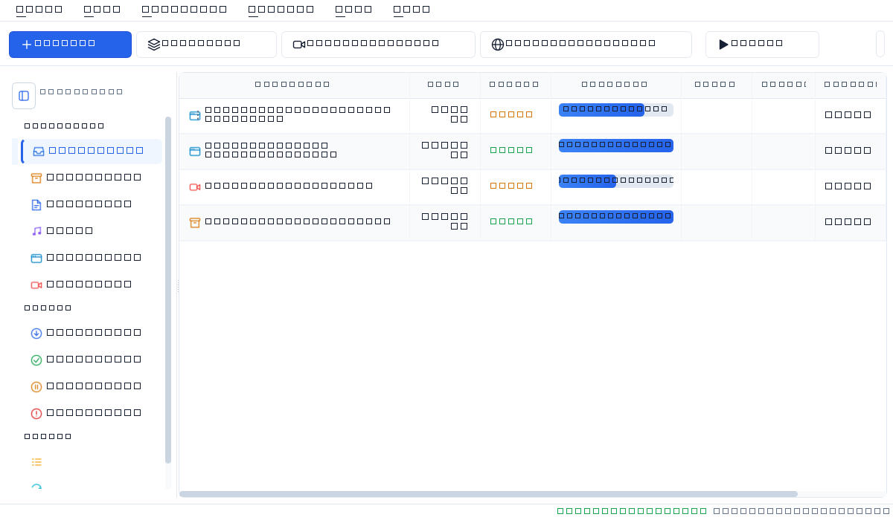

<div align="center">


# P-Downloader (Pure Downloader)

### Ultra High-Performance Desktop Download Accelerator & Bandwidth Manager
*A clean-room, cross-platform open-source download accelerator built from scratch in Python and PyQt6.*

[](https://github.com/pkgtm2419/p-downloader/actions/workflows/ci.yml)
[](https://github.com/pkgtm2419/p-downloader/actions/workflows/release.yml)
[](https://github.com/pkgtm2419/p-downloader/releases/latest)
[](https://www.python.org/)
[](LICENSE)
[](https://github.com/pkgtm2419/p-downloader/releases)

[**Download Releases**](https://github.com/pkgtm2419/p-downloader/releases/latest) •
[**Features**](#-features) •
[**Windows Installation**](#1-windows-installation) •
[**Linux Installation**](#2-linux-installation-ubuntudebianfedoraarch) •
[**macOS Installation**](#3-macos-installation) •
[**Browser Integration**](#-browser-extension-integration-chrome-edge-brave-firefox) •
[**CLI Mode**](#-cli-headless-mode) •
[**Build from Source**](#-building-and-packaging)

</div>

---

## ⚡ Overview

**P-Downloader** is a modern, open-source desktop download manager and acceleration engine. Designed as a clean alternative to legacy utilities like Internet Download Manager (IDM), P-Downloader maximizes bandwidth utilization through dynamic chunking, multi-adapter network bonding, resume resilience, streaming HLS parsing, FFmpeg remuxing, video stream sniffing, and browser interception across Windows, Linux, and macOS.

<div align="center">
  <br />
  
  <br />
  <em>P-Downloader v1.1.0 — IDM-Grade Dashboard with Multi-Segment Progress, Transfer Rates, and Collapsible Sidebar</em>
  <br />
</div>

---

## ✨ Features

### 🚀 High-Speed Multi-Connection Acceleration
- **Dynamic Connection Slicing**: Splits files into up to **32 concurrent streams** using HTTP `Range` headers to bypass server-side single-connection throttling.
- **Sparse File Pre-allocation**: Instantly reserves file capacity on disk, reducing fragmentation and eliminating write latency.

### 🎬 Universal Video Extraction & Streaming Engine (yt-dlp + FFmpeg)
- **1,000+ Video & Music Platforms**: Universal extractor powered by yt-dlp and FFmpeg seamlessly downloads full video or audio from YouTube, Vimeo, Twitter/X, TikTok, Reddit, Bilibili, Dailymotion, Twitch, Soundcloud, and hundreds more.
- **HLS (.m3u8) & DASH (.mpd) Engine**: Full support for fMP4 CMAF #EXT-X-MAP, AES-128 key rotation, separate audio rendition muxing (#EXT-X-MEDIA:TYPE=AUDIO), and continuous live stream recording.
- **Standalone yt-dlp Updater**: One-click or scheduled updater downloads signed releases from official GitHub assets with sha256 checksum verification and rollback.

### 🌐 Protocols & Swarm Downloads (FTP, BitTorrent & Debrid)
- **Resilient FTP & FTPS**: Full RFC 959 / 3659 client with TLS encryption (PROT P), REST restart markers, and passive mode.
- **Swarm BitTorrent Client**: Built-in BitTorrent task with tracker communication, piece visualizer map, and RSS automatic feed watcher.
- **Cloud Debrid Integration**: Multi-hoster support for Real-Debrid, AllDebrid, and Premiumize with automatic link un-restriction.
- **Multi-Volume Archive Extraction**: Unpacks .zip, .rar, .7z, and multi-volume .part01.rar / .z01 archives automatically upon download completion.

### 🔒 Privacy, Security & Anti-Leak (VPN Kill Switch & DoH)
- **VPN Fail-Closed Kill Switch**: Locks downloads to a dedicated VPN network adapter and halts all network traffic if the tunnel drops.
- **Encrypted DNS-over-HTTPS (DoH)**: Resolves hostnames via Cloudflare, Google, or Quad9 over TLS, bypassing ISP DNS tampering and SNI snooping.
- **SSRF IP Pinning & Private IP Blocking**: Validates resolved IPs and pins connections directly to validated socket addresses to block Server-Side Request Forgery.

### 🤖 Remote Automation, Headless Daemon & MCP Server
- **Web Remote Management Server**: Lightweight HTTP/WebSocket dashboard to monitor, pause, and add downloads remotely from mobile or browser.
- **Headless Docker & Daemon Mode**: Run without X11/Qt dependencies on NAS, Linux servers, and Docker containers (main_headless.py).
- **MCP Server for AI Assistants**: Model Context Protocol (MCP) tool server allowing AI assistants (Claude, Gemini, Antigravity) to query status, inspect speeds, and dispatch downloads directly.
- **IDM-Compatible CLI Switches**: Drop-in CLI replacement accepting /d [URL], /p [PATH], /f [FILENAME], /q, /s, and /a.

### 🎨 Modern UI, 9 Themes, Accessibility & AOT Native Compilation
- **9 Modern Curated Themes**: Tokyo Night, Nord, Cyberpunk, Solarized Dark, Gruvbox, Monokai Pro, Catppuccin Mocha, Modern Dark, and Classic Light.
- **High-Accessibility Screen Reader Support**: Dedicated Qt accessible names and descriptions for Narrator, NVDA, and Orca.
- **Multilingual & RTL Mirroring**: Fully translated dictionary with right-to-left UI mirroring for Arabic, Hebrew, and Persian.
- **Nuitka AOT Compilation**: Produces C-compiled native binaries with <30 MB RAM usage, instant startup, and zero Python runtime dependencies (scripts/build_native.py).

### 🌐 Multi-Network Bandwidth Aggregation (Bonding)
- **Multi-Adapter Pooling**: Automatically detects all active network interfaces (e.g., Ethernet + Wi-Fi + 5G USB/Hotspot tethering).
- **Socket Source Binding**: Pins concurrent HTTP segment connections across distinct physical network adapters to aggregate total available bandwidth.

### 🔄 Resilient Pause, Resume & Expired Link Recovery
- **Zero-Loss Pause & Resume**: Saves live chunk offsets in `.pdownload` sidecar state files. Downloads can be resumed after network drops or machine restarts.
- **Refresh Download Address (IDM-Grade)**: When temporary pre-signed links (Google Drive, Dropbox, Rapidgator, MEGA) expire with HTTP 401/403/410, seamlessly update the target URL without restarting from 0%.

### 🧲 Torrent & Magnet Link Support
- **Built-in Bencode/Bdecode Parser**: Native extraction of `.torrent` file metadata and BitTorrent parameters without heavy external dependencies.
- **Magnet Link Resolution**: Parses display names, info hashes, and multi-tier tracker addresses instantly.

### 🔒 Site Logins & Authentication Injection
- **Domain Credentials Store**: Securely stores basic HTTP and Bearer token credentials for private repositories, corporate intranets, and authenticated file servers.
- **Automatic Header Injection**: Matches target URLs to domain profiles and applies authentication automatically.

### 🛡️ IDM-Grade Robustness & v2 Architecture
- **Strict HTTP Capability Probing**: Strict bounded Range GET probe detects servers that falsely claim `Accept-Ranges: bytes` but return HTTP 200, automatically falling back to robust single-stream downloads without file corruption.
- **Durable Staging & Atomic Publish**: Downloads write verified blocks into `.part` staging stores with SQLite journaling. Only completely verified downloads are atomically published (`os.replace`) to the destination filename.
- **Shared Block Queue & Tail Optimization**: Slices large files into 1-8 MiB verified blocks with work claiming, hedged tail scheduling to bypass slow straggler streams, and cooperative pause/resume.
- **Dynamic Adaptive Concurrency**: Real-time closed-loop AIMD controller dynamically adjusts stream counts according to server rate limits (429/503), disk backpressure, and network conditions.
- **Shared Bandwidth Token Bucket**: Enforces system-wide resource limits across all active tasks (max active downloads, global streams, and per-origin/per-route stream caps).
- **Transactional Protocol v2 Native Messaging**: 2-phase reservation (`reserve` -> `commit` -> `release` -> `status`) ensures browser extension handoffs never drop downloads or desynchronize.
- **Origin-Scoped Auth & Secret Redaction**: Prevents credentials leakage across cross-origin redirects and automatically masks tokens, cookies, and passwords in diagnostic logs.

### ⏱️ High-Precision Speed Limiter & Multi-Queue Scheduler
- **Token-Bucket Throttling**: Restrict transfer speeds from 100 KB/s up to Gigabit capacity so background downloads never disrupt gaming, VoIP, or video streaming.
- **Timed Multi-Queue Scheduler**: Automate off-peak queues with automatic computer shutdown, sleep, or network disconnect.

### 🖥️ Native Desktop Experience & System Tray
- **Modern Dark Interface**: Custom high-DPI desktop UI built with PyQt6.
- **Live Segment Visualizer**: Real-time progress bars showcasing individual download streams and network adapter allocations.
- **Single-Instance IPC**: Running background instances accept new downloads instantly from the command line or browser extension.
- **System Tray Execution**: Minimize to the system notification tray with completion alerts.

---

## 🏗️ Architecture & Component Overview

```
                          ┌──────────────────────────┐
                          │   Browser Integration    │
                          │   (Chrome / Edge MV3)    │
                          └─────────────┬────────────┘
                                        │ Native Messaging IPC
                                        ▼
┌───────────────────────┐  IPC  ┌──────────────────────────┐
│   CLI Engine Mode     │ ◄───► │  PyQt6 Desktop GUI &     │
│  (Headless Terminal)  │       │  System Tray Controller  │
└───────────┬───────────┘       └────────────┬─────────────┘
            │                                │
            └───────────────────┬────────────┘
                                │
                                ▼
                   ┌──────────────────────────┐
                   │  Central Download Engine │
                   │  (Queue / Task Manager)  │
                   └────────────┬─────────────┘
                                │
        ┌───────────────────────┼───────────────────────┐
        ▼                       ▼                       ▼
┌────────────────┐      ┌────────────────┐      ┌────────────────┐
│ SQLite Database│      │  Multi-Adapter │      │ Speed Limiter  │
│  Persistence   │      │Bandwidth Bond  │      │(Token Bucket)  │
└────────────────┘      └───────┬────────┘      └────────────────┘
                                │
                                ▼
                   ┌──────────────────────────┐
                   │ Segmented Range Worker   │
                   │ (Up to 32 Parallel Conns)│
                   └────────────┬─────────────┘
                                │
                                ▼
                   ┌──────────────────────────┐
                   │ Sparse Preallocated Disk │
                   │ + .pdownload Meta State  │
                   └──────────────────────────┘
```

---

## 📥 Downloads & Official Releases

You can download compiled release packages from the [**GitHub Releases**](https://github.com/pkgtm2419/p-downloader/releases/latest) page:

| Package File | Operating System | Description | Direct Download |
| :--- | :--- | :--- | :--- |
| **P-Downloader-Setup.exe** | **Windows** (10/11 x64) | Full Windows Setup Installer with Desktop icon & Startup entry | [📥 **Download Setup (.exe)**](https://github.com/pkgtm2419/p-downloader/releases/latest/download/P-Downloader-Setup.exe) |
| **P-Downloader-Portable.exe** | **Windows** (10/11 x64) | Zero-install standalone executable for USB drives / portable usage | [⚡ **Download Portable (.exe)**](https://github.com/pkgtm2419/p-downloader/releases/latest/download/P-Downloader-Portable.exe) |
| **P-Downloader-Windows-x64-Portable.zip** | **Windows** (x64) | Standalone portable folder with executable and all bundled libraries | [📦 **Download Archive (.zip)**](https://github.com/pkgtm2419/p-downloader/releases/latest/download/P-Downloader-Windows-x64-Portable.zip) |
| **P-Downloader-Linux-x64.tar.gz** | **Linux** (x64) | Standalone Linux portable package (tarball) | [🐧 **Download Linux (.tar.gz)**](https://github.com/pkgtm2419/p-downloader/releases/latest/download/P-Downloader-Linux-x64.tar.gz) |
| **pdownloader-browser-extension.zip** | **All Platforms** | Chrome, Edge, Brave, and Firefox WebExtension | [🌐 **Download Extension (.zip)**](https://github.com/pkgtm2419/p-downloader/releases/latest/download/pdownloader-browser-extension.zip) |
| **SHA256SUMS.txt** | **All Platforms** | Cryptographic verification checksums for every release file | [🔒 **Download Checksums**](https://github.com/pkgtm2419/p-downloader/releases/latest/download/SHA256SUMS.txt) |
---

## 📦 Complete Installation Guide (Every OS)

### 1. Windows Installation

#### Option A: 1-Click Native Windows Installer (Recommended for Windows 11 & 10)
> [!TIP]
> **Windows 11 Smart App Control (SAC) Compatible**: Windows 11 22H2+ includes Smart App Control, which may block newly compiled open-source standalone `.exe` files that have not yet accumulated cloud reputation with Microsoft Defender. The 1-Click Native Installer uses the official Microsoft-trusted Python runtime and is **100% immune to Smart App Control blocks**.

1. Download or clone this repository:
   ```cmd
   git clone https://github.com/pkgtm2419/p-downloader.git
   cd p-downloader
   ```
2. Double-click **`install_windows.bat`** (or in PowerShell run `.\install_windows.ps1`).
3. The installer automatically:
   - Validates / installs required dependencies (`requirements.txt`).
   - Creates a **Desktop shortcut** (`P-Downloader.lnk`) with the official high-resolution icon.
   - Creates a **Start Menu shortcut** in `Programs > P-Downloader`.
   - Registers browser extension **Native Messaging Hosts** for Chrome, Edge, Brave, Chromium, and Firefox in `HKCU`.
   - Registers P-Downloader in Windows **Settings > Apps > Installed Apps** with a full uninstaller (`uninstall_windows.bat`).
4. Launch P-Downloader directly from your Desktop or Start Menu!

#### Option B: Windows Setup Wizard Installer (`P-Downloader-Setup.exe`)
1. Download **`P-Downloader-Setup.exe`** from [GitHub Releases](https://github.com/pkgtm2419/p-downloader/releases/latest).
2. Run the installer wizard. If an existing version of P-Downloader is already present, the setup will automatically detect it and ask whether you want to upgrade (preserving history and settings) or perform a clean reinstall.
3. **If Windows 11 Smart App Control blocks the file** (*"An Application Control policy has blocked this file"*):
   - Right-click `P-Downloader-Setup.exe` > **Properties** > Check **Unblock** at the bottom > Click **Apply**.
   - Alternatively, use **Option A (`install_windows.bat`)** above, or navigate to *Windows Security > App & browser control > Smart App Control settings* and set to *Evaluation* or *Off*.
4. Launch P-Downloader from your Start Menu or Desktop shortcut.

#### Option C: Portable Mode
1. Download **`P-Downloader-Portable.exe`** or extract **`P-Downloader-Windows-x64-Portable.zip`**.
2. Double-click `P-Downloader-Portable.exe` to run immediately without installation.

#### Option D: Run from Source
```powershell
# 1. Clone repository
git clone https://github.com/pkgtm2419/p-downloader.git
cd p-downloader

# 2. Create virtual environment
python -m venv .venv
.\.venv\Scripts\Activate.ps1

# 3. Install dependencies
pip install -r requirements.txt

# 4. Launch app
python main.py
# Or double-click: run_pdownloader.bat
```

---

### 2. Linux Installation (Ubuntu, Debian, Fedora, Arch)

#### Option A: Standalone Binary Package
1. Download **`P-Downloader-v1.1.0-Linux-x64.tar.gz`** from [GitHub Releases](https://github.com/pkgtm2419/p-downloader/releases/latest).
2. Extract the archive:
   ```bash
   tar -xvf P-Downloader-v1.1.0-Linux-x64.tar.gz
   cd P-Downloader
   ./P-Downloader
   ```

#### Option B: Run from Source on Linux
1. **Install system dependencies**:
   - **Ubuntu / Debian / Linux Mint**:
     ```bash
     sudo apt update
     sudo apt install -y python3 python3-pip python3-venv libegl1 libgl1 libxkbcommon-x11-0 libdbus-1-3 ffmpeg
     ```
   - **Fedora / RHEL**:
     ```bash
     sudo dnf install -y python3 python3-pip mesa-libGL mesa-libEGL libxkbcommon-x11 ffmpeg
     ```
   - **Arch Linux / Manjaro**:
     ```bash
     sudo pacman -S python python-pip libxkbcommon xcb-util-cursor ffmpeg
     ```

2. **Clone and run**:
   ```bash
   git clone https://github.com/pkgtm2419/p-downloader.git
   cd p-downloader
   python3 -m venv .venv
   source .venv/bin/activate
   pip install -r requirements.txt
   ./run_pdownloader.sh
   ```

3. **Install Linux Desktop Icon & Launcher** (Optional):
   ```bash
   chmod +x run_pdownloader.sh
   cp pdownloader.desktop ~/.local/share/applications/
   ```

---

### 3. macOS Installation

#### Option: Run from Source (macOS 12+ Monterey, Ventura, Sonoma, Sequoia)

1. **Install Python 3 and FFmpeg** (via Homebrew):
   ```bash
   # Install Homebrew if not already installed (https://brew.sh)
   brew install python@3.12 ffmpeg
   ```

2. **Clone and set up**:
   ```bash
   git clone https://github.com/pkgtm2419/p-downloader.git
   cd p-downloader
   python3 -m venv .venv
   source .venv/bin/activate
   pip install -r requirements.txt
   ```

3. **Launch**:
   ```bash
   ./run_pdownloader.sh
   # Or directly:
   python3 main.py
   ```

---


---

### 4. Docker & Headless Server (Linux / NAS / Unraid / Synology)

Run P-Downloader in background daemon mode on any home server, VPS, or NAS without X11/Qt display dependencies:

#### Option A: Docker Container
```bash
# Pull and run container
docker run -d \
  --name pdownloader \
  --restart unless-stopped \
  -p 8088:8088 \
  -v ~/Downloads:/downloads \
  -v ~/.pdownloader:/root/.pdownloader \
  -e PDOWNLOADER_TOKEN="your-secure-token" \
  pkgtm2419/p-downloader:latest
```

#### Option B: Docker Compose
```yaml
version: '3.8'
services:
  pdownloader:
    image: pkgtm2419/p-downloader:latest
    container_name: pdownloader
    restart: unless-stopped
    ports:
      - "8088:8088"
    volumes:
      - ~/Downloads:/downloads
      - ~/.pdownloader:/root/.pdownloader
    environment:
      - PDOWNLOADER_PORT=8088
      - PDOWNLOADER_TOKEN=your-secret-api-token
```

#### Option C: Systemd Service (Headless Linux Daemon)
Create `/etc/systemd/system/pdownloader.service`:
```ini
[Unit]
Description=P-Downloader Headless Server
After=network.target

[Service]
Type=simple
User=pdownloader
WorkingDirectory=/opt/p-downloader
ExecStart=/opt/p-downloader/.venv/bin/python main_headless.py --web-port 8088
Restart=always
RestartSec=5

[Install]
WantedBy=multi-user.target
```
```bash
sudo systemctl daemon-reload
sudo systemctl enable --now pdownloader
```

---

### 5. MCP Server for AI Assistants (Claude, Gemini, Antigravity)

Connect P-Downloader to your AI coding agents and assistants via the Model Context Protocol:

Add to your `claude_desktop_config.json` or `antigravity.mcp.json`:
```json
{
  "mcpServers": {
    "pdownloader": {
      "command": "python",
      "args": ["/path/to/p-downloader/scripts/pdownloader_mcp.py"]
    }
  }
}
```
Available AI tools: `pdownloader_add_download`, `pdownloader_list_downloads`, `pdownloader_pause`, `pdownloader_resume`, `pdownloader_status`.

## 🌐 Browser Extension Integration (Chrome, Edge, Brave, Firefox)

P-Downloader includes an official Manifest V3 browser extension and a native messaging host bridge for instant browser interception and in-page video sniffing.

### Step 1: Register Native Messaging Host
Run the automated registrar script:
- **Windows**:
  ```cmd
  python browser_extension\installer.py
  ```
- **Linux & macOS**:
  ```bash
  python3 browser_extension/installer.py
  ```
*This automatically registers `com.pdownloader.host` in your OS registry or browser manifest directories.*

### Step 2: Load the WebExtension in Your Browser
1. In your browser, open the extensions manager:
   - **Chrome / Brave**: `chrome://extensions`
   - **Microsoft Edge**: `edge://extensions`
   - **Firefox**: `about:debugging#/runtime/this-firefox`
2. Turn ON **Developer mode** (top-right toggle).
3. Click **Load unpacked** (or extract `pdownloader-browser-extension-v1.1.0.zip`).
4. Select the `browser_extension` folder.
5. You're ready! Right-click any downloadable link or click the floating video download pill on media pages.

---

## 💻 CLI (Headless Mode)

P-Downloader includes a headless command-line interface suitable for remote Linux servers, Docker containers, and automated cron pipelines:

```bash
# Basic high-speed download (8 connections)
python main.py --cli --url "https://example.com/archive.iso"

# Ultra multi-connection download (32 parallel connections to custom path)
python main.py --cli --url "https://example.com/dataset.zip" --connections 32 --output "/data/dataset.zip"

# Download a torrent or magnet link
python main.py --cli --url "magnet:?xt=urn:btih:..."

# Check version
python main.py --version
```

### Command-line Arguments
| Argument | Description | Default |
| :--- | :--- | :--- |
| `--url <URL>` | Download target URL / Magnet URI | `""` |
| `--connections <N>` | Number of concurrent connection segments (`1-32`) | `8` |
| `--output <PATH>` | Custom destination file path | Category default |
| `--cli` | Run in headless console mode without GUI | `False` |
| `--tray` / `--minimized`| Launch minimized directly into System Tray | `False` |
| `--version`, `-v` | Display application version and exit | - |

---

## 🔨 Building and Packaging

### 1. Windows PyInstaller & Inno Setup
```cmd
pip install -r requirements-dev.txt

# Directory distribution (used by installer)
python -m PyInstaller --clean -y pdownloader.spec

# Single-file portable executable
python -m PyInstaller --clean -y P-Downloader-Portable.spec

# Inno Setup Windows installer
build_installer.bat 1.1.0
```

### 2. Linux Standalone Bundle
```bash
pip install -r requirements-dev.txt
python3 -m PyInstaller --clean -y pdownloader.spec
tar -czvf P-Downloader-v1.1.0-Linux-x64.tar.gz -C dist P-Downloader
```

---

## 🤖 GitHub Actions Automated Releases

When a version tag is pushed (e.g. `v1.1.0`), the [`.github/workflows/release.yml`](.github/workflows/release.yml) workflow automatically:
1. Runs all unit, integration, and browser test suites.
2. Compiles the Windows Setup `.exe`, portable `.exe`, and portable `.zip`.
3. Compiles the Linux standalone portable package `.tar.gz`.
4. Bundles the Chrome/Edge WebExtension `.zip`.
5. Computes SHA-256 hashes in `SHA256SUMS.txt`.
6. Publishes the release on GitHub with release notes.

To trigger a release manually:
1. Go to **Actions** → **Release** in your GitHub repository.
2. Click **Run workflow**, specify the version (e.g. `1.1.0`), and run.

---

## 🛡️ Security & Privacy

- **Clean-room Codebase**: Zero telemetry, tracking, or adware.
- **Local Storage Only**: All credentials and download logs stay on your local disk at `~/.pdownloader/downloads.db`.
- **Pre-flight CI Security**: Barred by `.gitignore` against accidental credential/environment leakage.

---

## 📄 License

This project is licensed under the [**MIT License**](LICENSE). Free for personal and commercial use.
