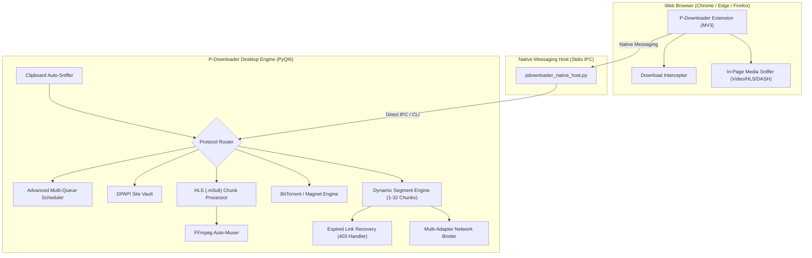

# P-Downloader: Ultra Upgrade & Architecture Plan
> **Generated from Comparative Analysis**: P-Downloader vs. Awesome Downloader vs. Internet Download Manager (IDM)  
> **Target Version**: P-Downloader v2.0 Ultra  
> **Tech Stack**: Python 3.12 + PyQt6 (Native Desktop Engine) + Manifest V3 Browser Extension

---

## 1. Executive Summary & Vision

Based on our in-depth audit of **P-Downloader**, **Ahmadkhattak1/awesome-downloader**, and **Internet Download Manager (IDM)**, P-Downloader already possesses distinct competitive advantages:
- **BitTorrent / Magnet Swarm Engine** (which IDM and Awesome Downloader both lack).
- **Multi-Adapter Network Bonding** ([`core/network_binder.py`](file:///d:/p-downloader/core/network_binder.py): striping connections across Wi-Fi + Ethernet simultaneously).
- **IDM-Style Expired Link Refresh Dialog** ([`gui/refresh_dialog.py`](file:///d:/p-downloader/gui/refresh_dialog.py) for expired 403/410 tokens).
- **Encrypted DPAPI Site Vault** ([`core/credentials_manager.py`](file:///d:/p-downloader/core/credentials_manager.py)).
- **Low Memory Footprint** (~35–50 MB RAM vs Electron's ~200+ MB).

However, to become the **definitive open-source Ultra Downloader** that completely replaces IDM and surpasses Awesome Downloader, P-Downloader needs to close **four major feature gaps**:
1. **In-Page Browser Video Sniffing & Quality Picker** (The killer feature of IDM and Awesome Downloader).
2. **HLS (.m3u8) / DASH Stream Downloader & FFmpeg Auto-Muxing** (Merging separate 1080p/4K audio+video tracks).
3. **Advanced Multi-Queue Scheduler with Windows Power Management** (Timed off-peak queues, auto-sleep, auto-shutdown).
4. **Site Grabber / Web Crawler & Background Clipboard Monitor** (Batch asset crawler and instant clipboard popup).



---

## 2. Gap Analysis Matrix: What We Are Missing

| Priority | Missing / Upgrade Feature | Reference Benchmark | Impact | Implementation Difficulty |
| :---: | :--- | :--- | :---: | :---: |
| **P0** | **In-Page Video Sniffer & Quality Dropdown** | Awesome Downloader (`youtube-media.js`, `hls.js`) & IDM Video Bar | 🌟 Extreme | Medium |
| **P0** | **HLS (.m3u8) & DASH Multi-Chunk Parser** | Awesome Downloader (`core/hls.mjs`) & IDM | 🌟 Extreme | Medium |
| **P0** | **FFmpeg Post-Download Auto-Remuxer** | Awesome Downloader (`core/mux.mjs` + `ffmpeg-static`) | 🌟 Extreme | Low |
| **P1** | **Clipboard URL Auto-Detector & Instant Popup** | IDM Clipboard Monitor | 🚀 High | Low |
| **P1** | **Advanced Multi-Queue Scheduler & Windows Power Actions** | IDM Scheduler (Queue timing, Shutdown, Sleep on finish) | 🚀 High | Medium |
| **P2** | **Windows Defender Post-Download Antivirus Hook** | IDM Antivirus Integration (`MpCmdRun.exe`) | 👍 Medium | Low |
| **P2** | **IDM-Style Site Grabber / Web Spider** | IDM Site Grabber (Crawl links, batch download images/docs) | 🚀 High | Medium-High |
| **P3** | **Zero-Copy Disk Allocation (Sparse Files)** | IDM File Allocation Engine | ⚡ Performance | Medium |

---

## 3. Detailed Technical Blueprint for New Features

### Feature 1: In-Page Video Sniffer & Floating Quality Badge
#### Overview:
Detect HTML5 `<video>` elements, HLS playlists (`.m3u8`), DASH manifests (`.mpd`), and streaming requests on sites like YouTube, Vimeo, Facebook, and Instagram. Render a non-intrusive floating **"Download Video with P-Downloader"** badge with a resolution picker (4K, 1080p, 720p, Audio MP3/M4A).

#### Architecture:
1. **Content Script (`browser_extension/video_sniffer.js`)**:
   - Observes DOM mutations for `<video>` elements and `src` attributes.
   - Monitors `window.performance.getEntriesByType('resource')` and `webRequest` API for media stream URLs.
   - Injects a sleek modern pill badge at the top-right corner of the video player.
2. **Quality Resolution Resolver**:
   - If HLS (`.m3u8`): parses the master playlist to extract bandwidth/resolution variants (`1920x1080`, `1280x720`).
   - If direct media: sends URL with browser cookies and user-agent header to P-Downloader native host.
3. **Payload to Native Host**:
   ```json
   {
     "action": "download_media",
     "url": "https://example.com/playlist.m3u8",
     "title": "Sample 4K Video",
     "page_url": "https://example.com/watch?v=123",
     "headers": {
       "User-Agent": "Mozilla/5.0 ...",
       "Referer": "https://example.com/"
     },
     "type": "hls",
     "selected_quality": "1080p"
   }
   ```

---

### Feature 2: HLS (.m3u8) Downloader & Automatic FFmpeg Remuxer
#### Overview:
Many modern streaming services split 1080p/4K into separate video-only and audio-only streams, or serve HLS segments (`.ts` or `.m4s`). P-Downloader should download all segments in parallel and remux them into a clean `.mp4`.

#### Architecture:
1. **HLS Engine ([`core/hls_downloader.py`](file:///d:/p-downloader/core/hls_downloader.py))**:
   - Parses `.m3u8` playlists using pure Python (extracts segment URLs and AES-128 encryption keys if present).
   - Feeds segments into the dynamic thread pool to download up to 16–32 chunks concurrently.
   - Decrypts segments in-memory (AES-128-CBC) if encrypted.
2. **FFmpeg Remuxing Engine ([`core/muxer.py`](file:///d:/p-downloader/core/muxer.py))**:
   - Auto-detects local `ffmpeg.exe` or uses a portable lightweight static binary.
   - Merges separate video and audio streams without re-encoding:
     ```powershell
     ffmpeg -i video_track.mp4 -i audio_track.m4a -c copy -movflags +faststart output.mp4
     ```
   - Emits real-time progress events to the PyQt6 UI ("Merging Audio & Video... 98%").

---

### Feature 3: Clipboard URL Auto-Sniffer & Instant Mini-Prompt
#### Overview:
When the user copies any downloadable link (e.g., `https://.../setup.zip`, `magnet:?xt=...`, `https://.../video.mp4`) in any application, P-Downloader detects it instantly in the background and surfaces a non-intrusive bottom-right toast or mini-dialog asking:
> *"Download 'setup.zip' (450 MB) with P-Downloader? [Download Now] [Download Later] [Dismiss]"*

#### Architecture:
1. **Clipboard Monitor ([`core/clipboard_monitor.py`](file:///d:/p-downloader/core/clipboard_monitor.py))**:
   - Uses `QClipboard.dataChanged` signal from PyQt6 (zero CPU overhead, event-driven).
   - Regex matches file extensions (`.zip`, `.rar`, `.7z`, `.tar.gz`, `.iso`, `.exe`, `.msi`, `.mp4`, `.mkv`, `.mp3`, `.pdf`) and URI schemes (`magnet:`, `ed2k://`, `ftp://`).
   - Ignores internal browser links and already-captured URLs.
2. **Mini Notification Window ([`gui/quick_prompt_dialog.py`](file:///d:/p-downloader/gui/quick_prompt_dialog.py))**:
   - Compact floating popup with smooth fade-in animation.
   - Allows changing download folder or queue with one click.

---

### Feature 4: Advanced Multi-Queue Scheduler & Windows Power Control
#### Overview:
Replicate IDM's legendary queue scheduler to enable overnight unattended downloading.

#### Architecture:
1. **Queue Management ([`core/queue_manager.py`](file:///d:/p-downloader/core/queue_manager.py))**:
   - Support multiple custom queues: `Default Queue`, `Night Sync (2AM - 6AM)`, `Large Files Queue`.
   - Per-queue concurrency limiter: set max simultaneous active downloads (e.g., 1 at a time to prevent server throttling).
2. **Scheduler Automation Daemon ([`core/scheduler_service.py`](file:///d:/p-downloader/core/scheduler_service.py))**:
   - Start queue at specific date/time (daily or on selected weekdays).
   - Stop queue at specific time or when all files in the queue are completed.
3. **Post-Download Power Execution**:
   - Execute Windows system command via Windows API:
     - **Sleep**: `SetSuspendState(False, False, False)`
     - **Hibernate**: `SetSuspendState(True, False, False)`
     - **Shutdown**: `shutdown.exe /s /t 60 /c "P-Downloader queue completed"`
     - **Disconnect Network / VPN**: `rasdial /disconnect`

---

### Feature 5: IDM-Style Site Grabber & Batch Downloader
#### Overview:
Enable downloading all assets (e.g. all images from an album, all PDFs from a university course, or all MP3s from a directory) from a single website link.

#### Architecture:
1. **Crawler Engine ([`core/spider.py`](file:///d:/p-downloader/core/spider.py))**:
   - Accepts root URL + maximum crawl depth (Level 1: current page only; Level 2: links on page).
   - Parses HTML using Python's standard `html.parser` or regex (fast, zero heavy dependencies).
   - Filters by category: Images (`.jpg`, `.png`, `.webp`), Documents (`.pdf`, `.docx`), Audio (`.mp3`, `.flac`), Archives (`.zip`).
2. **Site Grabber Wizard ([`gui/site_grabber_dialog.py`](file:///d:/p-downloader/gui/site_grabber_dialog.py))**:
   - 4-step wizard matching IDM's interface:
     - Step 1: Enter Start URL and project name.
     - Step 2: Set save path and crawl depth.
     - Step 3: Select file filters and pattern wildcards.
     - Step 4: Preview tree of discovered files with checkboxes to start downloading.

---

### Feature 6: Windows Defender Post-Download Antivirus Hook
#### Overview:
Immediately after file assembly and hash verification, automatically scan the completed file using Microsoft Defender or user-configured antivirus before alerting the user.

#### Implementation ([`core/antivirus.py`](file:///d:/p-downloader/core/antivirus.py)):
- Executes Windows Defender command-line utility:
  ```powershell
  "C:\Program Files\Windows Defender\MpCmdRun.exe" -Scan -ScanType 3 -File "<file_path>"
  ```
- If clean, marks download status as `Completed (Verified Clean)`.
- If threats detected, moves file to quarantine and warns user immediately.

---

### Feature 7: Zero-Copy Pre-Allocation (Sparse Files)
#### Overview:
When allocating a 50 GB file across 32 connections, writing chunks randomly causes massive NTFS disk fragmentation and UI freeze.
- Use the Win32 API (`SetFileInformationByHandle` with `FileAllocationInformation` or `SetFileValidData`) to instantly allocate file size on NTFS in 0.01 seconds without writing dummy zero bytes.

---

## 4. Phased Implementation Roadmap


### Phase 1: Video Capture & Media Engine (Immediate Priority)
- [ ] Create `browser_extension/content_video.js` with floating "Download Video" badge.
- [ ] Create `core/hls_downloader.py` to parse `.m3u8` playlists and download chunk segments concurrently.
- [ ] Implement `core/muxer.py` using `ffmpeg` for non-transcoding stream remuxing.
- [ ] Add Video Quality Selection Dialog in `gui/video_quality_dialog.py`.

### Phase 2: Automation, Clipboard & Multi-Queue
- [ ] Implement `core/clipboard_monitor.py` for instant URL sniffing.
- [ ] Build `gui/quick_prompt_dialog.py` for bottom-right toast download prompts.
- [ ] Enhance `core/scheduler_service.py` with multi-queue scheduling and Windows power actions (Sleep / Shutdown).
- [ ] Upgrade `gui/scheduler_dialog.py` to support custom named queues.

### Phase 3: Site Grabber & Security
- [ ] Implement `core/spider.py` crawler engine.
- [ ] Build `gui/site_grabber_dialog.py` step-by-step wizard.
- [ ] Implement `core/antivirus.py` for automatic Microsoft Defender post-download scans.

### Phase 4: Performance & Packaging
- [ ] Add NTFS sparse-file / fast file allocation in `core/segment.py`.
- [ ] Update universal installer scripts (`build_universal_setup.py`) with updated browser extension and tools.
- [ ] Verify test suite and compile standalone installer.

---

## 5. Verification & Acceptance Criteria
1. **Video Sniffing**: Opening YouTube, Vimeo, or standard MP4/HLS streams displays the P-Downloader video badge and downloads 1080p/4K files with synchronized audio.
2. **Clipboard**: Copying a `.zip` or `magnet:` link in any browser or app immediately prompts to download without opening the main window.
3. **Scheduler**: Queue successfully starts at scheduled time, finishes downloads sequentially, and invokes configured action (e.g., Sleep/Exit).
4. **Site Grabber**: Pointing to an image gallery or document index extracts all asset links and queues them in one batch.
5. **Stability & SAC Compliance**: Application continues to pass all unit tests and install cleanly without triggering Windows Smart App Control blocks.
