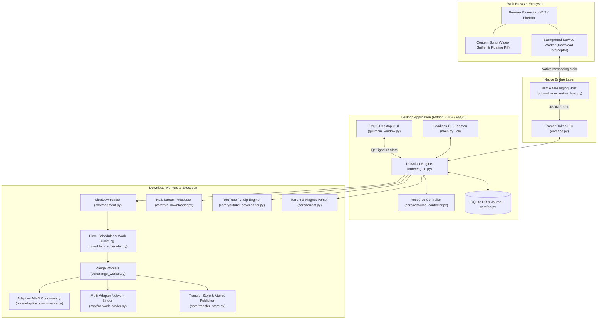

# P-Downloader Documentation Hub

Welcome to the **P-Downloader (Pure Downloader)** developer and operations documentation hub. This repository contains the complete documentation suite required to develop, test, maintain, secure, and release P-Downloader.

---

## 📚 Documentation Index

| Document | Focus Area | Description |
| :--- | :--- | :--- |
| [**Architecture & System Design**](file:///docs/architecture.md) | System Design | Detailed architecture, component topology, multi-threaded engine, block scheduling, adaptive concurrency, and IPC protocols. |
| [**Getting Started**](file:///docs/getting-started.md) | Dev Setup | Prerequisites, Python virtual environment (`.venv`), dependency installation, running in GUI or Headless CLI modes. |
| [**Development Guide**](file:///docs/development-guide.md) | Coding & Patterns | Code conventions, folder structure, download lifecycle, adding features, Qt signal contracts, and debug workflows. |
| [**Core Engine API Reference**](file:///docs/core-engine-api.md) | Technical Reference | Deep dive into `core/` modules: `DownloadEngine`, `UltraDownloader`, `BlockScheduler`, `RangeWorker`, `TransferStore`, etc. |
| [**GUI Architecture & Design**](file:///docs/gui-architecture.md) | Frontend / PyQt6 | PyQt6 interface architecture, reactive thread boundaries, custom dark styling, segment visualizer, and modal dialogs. |
| [**Browser Extension Integration**](file:///docs/browser-extension.md) | WebExtension & IPC | Manifest V3 extension, in-page media sniffer, native messaging host protocol, 2-phase handoff transactions (`reserve`/`commit`). |
| [**Testing & Quality Assurance**](file:///docs/testing-guide.md) | QA & Automation | Test strategy, running `pytest`, `FaultOrigin` mock HTTP server, chaos engineering, unit/integration suites, and test writing. |
| [**Packaging & Distribution**](file:///docs/packaging-and-distribution.md) | DevOps & Builds | PyInstaller compilation, Windows Inno Setup installer (`installer.iss`), portable builds, Linux packages, and versioning. |
| [**Security & Threat Model**](file:///docs/security-model.md) | Security Hardening | Credential encryption (Fernet), origin-scoped auth injection, SSRF defense, IPC secret redaction, and token authorization. |
| [**Troubleshooting & FAQ**](file:///docs/troubleshooting-and-faq.md) | Operations & Support | Resolving network timeouts, expired URLs (403/410), FFmpeg dependencies, antivirus false positives, and diagnostic logs. |
| [**Contributing Guidelines**](file:///docs/contributing.md) | SDLC & Workflow | Git branching model, conventional commits, pull request review requirements, code style standards, and release checklist. |
| [**Browser Support Matrix**](file:///docs/browser-support.md) | Browser Compatibility | Native messaging host support status across Chrome, Edge, Brave, and Firefox. |
| [**Performance Benchmarks**](file:///docs/benchmarks/v2-results.md) | Benchmarking | Throughput, multi-adapter bonding speedup, and resource consumption metrics. |

---

## 🧭 System Overview



---

## 🛠️ Quick Commands

```powershell
# 1. Activate Virtual Environment
.\.venv\Scripts\Activate.ps1

# 2. Run Desktop GUI Application
python main.py

# 3. Run Headless CLI Mode
python main.py --cli "https://example.com/file.zip" --connections 16

# 4. Run Test Suite
python -m pytest tests/test_adaptive_concurrency.py tests/test_block_scheduler.py

# 5. Check Code Style
flake8 core gui tests --max-line-length=120
```

