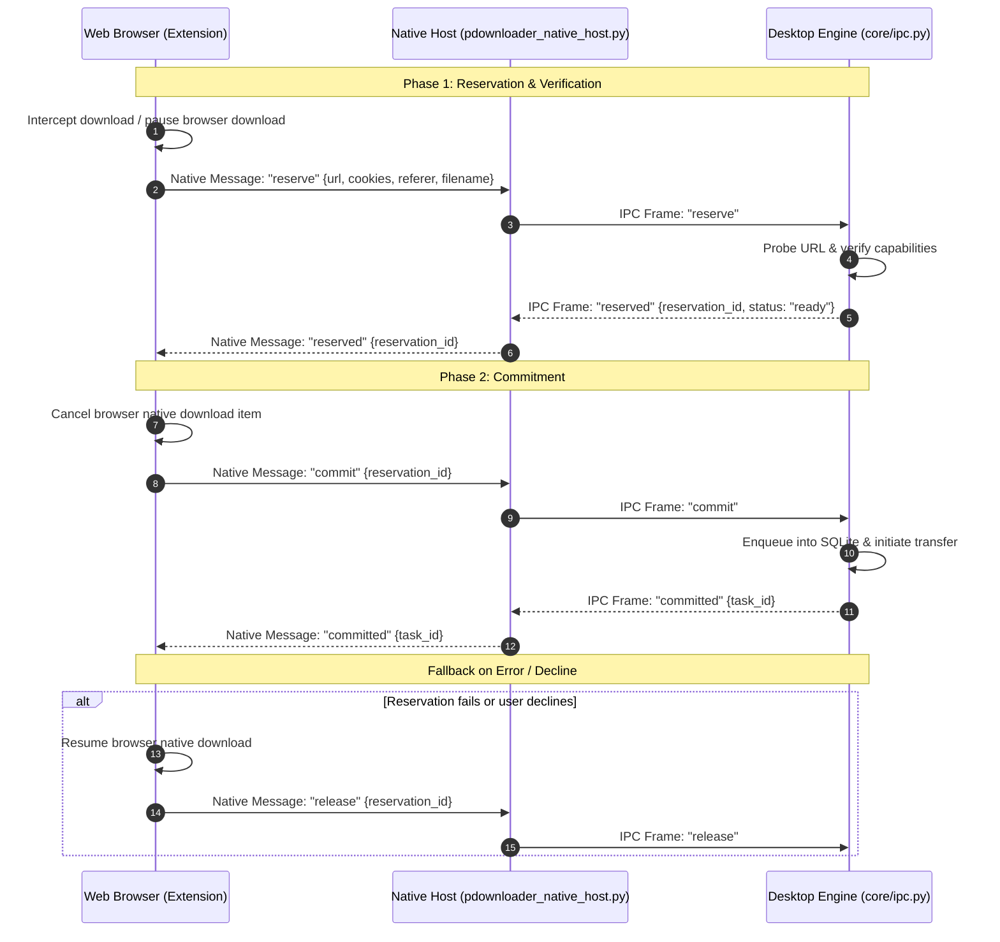

# P-Downloader Architecture & System Design

This document details the high-level and subsystem architecture of **P-Downloader (Pure Downloader)**, an IDM-grade desktop download accelerator and bandwidth management engine.

---

## 1. System Overview

P-Downloader is engineered as a clean-room, decoupled architecture dividing responsibilities cleanly across:
- **Presentation Layer**: PyQt6 reactive desktop GUI ([`gui/main_window.py`](file:///gui/main_window.py)) or Headless CLI runner ([`main.py`](file:///main.py)).
- **Orchestration Layer**: Central `DownloadEngine` ([`core/engine.py`](file:///core/engine.py)) and global `ResourceController` ([`core/resource_controller.py`](file:///core/resource_controller.py)).
- **Transfer Engine**: Sliced multi-stream workers (`UltraDownloader`, `RangeWorker`, `BlockScheduler`).
- **Persistence Layer**: SQLite database (`core/db.py`) and atomic file staging (`core/transfer_store.py`).
- **External Integration**: Manifest V3 WebExtension and Stdio Native Messaging Bridge (`browser_extension/`).

```
┌─────────────────────────────────────────────────────────────┐
│                       Presentation Layer                    │
│   PyQt6 GUI Main Window (High DPI)   │    CLI Headless Mode  │
└──────────────────────────────┬──────────────────────────────┘
                               │ Qt Signals / Thread-Safe Calls
┌──────────────────────────────▼──────────────────────────────┐
│                      Orchestration Layer                    │
│       DownloadEngine       │      ResourceController        │
│   (Queue, State Machine)   │   (Tokens, Global Bandwidth)   │
└──────────────┬──────────────────────────────┬───────────────┘
               │                              │
┌──────────────▼──────────────┐┌──────────────▼───────────────┐
│     Worker Subsystems       ││      Persistence Engine      │
│  - UltraDownloader (HTTP)   ││  - SQLite Database (db.py)   │
│  - BlockScheduler & AIMD    ││  - TransferStore (.part)     │
│  - Multi-Adapter Binder     ││  - .pdownload State Journal  │
│  - HLS & YouTube (yt-dlp)   ││  - Credentials Vault (Fernet)│
│  - Torrent / Magnet Parser  ││                              │
└─────────────────────────────┘└──────────────────────────────┘
```

---

## 2. Concurrency & Threading Model

To maintain 60 FPS UI responsiveness while driving multi-gigabit throughput:
1. **Main UI Thread (PyQt6 Event Loop)**:
   - Owns all widget instantiations, rendering, animations, user input, and system tray integration.
   - **Never blocks on I/O or network calls**.
   - Receives state updates exclusively through thread-safe Qt Signals (`pyqtSignal(dict)`).
2. **Download Engine Orchestration Thread**:
   - Manages task queues, prioritizes pending items, coordinates scheduler triggers, and reconciles state with SQLite.
3. **Download Task Worker Threads (`QThread` / `threading.Thread`)**:
   - Each active download runs an independent worker coordinating sub-components.
4. **Range Worker Thread Pool**:
   - Spawns up to 32 concurrent HTTP range workers per download.
   - Workers cooperatively pull chunks from a shared queue rather than operating on static, inflexible slices.
   - Respects cooperative cancellation flags (`stop_requested.is_set()`) to terminate gracefully within milliseconds.

```
Main Qt Event Loop (gui/main_window.py)
   │
   ├─► Signals/Slots (Status, Speed, Progress) ◄─── (Thread-safe)
   │
Engine Orchestration (core/engine.py)
   │
   ├── Task 1: UltraDownloader (core/segment.py)
   │     ├── BlockScheduler (core/block_scheduler.py)
   │     ├── Worker Thread 1 (RangeWorker -> Socket NIC A)
   │     ├── Worker Thread 2 (RangeWorker -> Socket NIC B)
   │     └── Worker Thread N (RangeWorker -> Socket NIC ...)
   │
   └── Task 2: HLSDownloader (core/hls_downloader.py)
         └── Playlist Chunk Consumer -> FFmpeg Muxer
```

---

## 3. Core Transfer Engine Subsystems

### 3.1 Strict HTTP Capability Probing (`core/http_probe.py`)
Legacy downloaders assume servers supporting `Accept-Ranges: bytes` always permit range slicing. In reality, broken or throttling CDNs often respond with HTTP `200 OK` (delivering the whole file from byte 0) instead of HTTP `206 Partial Content`. Writing whole bodies into segmented file offsets produces catastrophic silent corruption.

P-Downloader executes a strict capability probe:
1. Issues a bounded `Range: bytes=0-0` or `bytes=0-1023` request.
2. Validates that the response status is strictly `206 Partial Content`.
3. Validates the `Content-Range` header format (e.g. `bytes 0-1023/10485760`).
4. Captures and records the server `ETag` and `Last-Modified` headers to detect upstream content mutations.
5. If the server responds with `200 OK` or invalid range headers, P-Downloader automatically falls back to **safe single-stream download mode** without chunk corruption.

### 3.2 Block-Based Dynamic Scheduling (`core/block_scheduler.py`)
Rather than dividing a 1 GB file into static equal segments (which stalls whenever one segment encounters a slow route), P-Downloader divides files into small, verified blocks (typically 1 MiB to 8 MiB):
- **Work Claiming**: Range workers dynamically claim the next contiguous block from a shared work queue.
- **Hedged Tail Scheduling**: As a download nears 100%, trailing blocks remaining on slow or degraded streams are speculatively duplicated on idle faster streams. The first stream to complete the block wins; the slower duplicate is cooperatively aborted.
- **Cooperative Pause & Resume**: When paused, workers finish their active block or cleanly abort without discarding gigabytes of progress.

### 3.3 Dynamic Adaptive Concurrency (`core/adaptive_concurrency.py`)
Employs an AIMD (Additive Increase / Multiplicative Decrease) closed-loop controller:
- **Additive Increase**: When all active streams maintain healthy read throughput and error-free responses, additional streams are opened (up to the user's ceiling, e.g., 32).
- **Multiplicative Decrease**: Upon encountering HTTP `429 Too Many Requests`, HTTP `503 Service Unavailable`, or connection resets, stream count is immediately halved and a backoff penalty interval is applied.
- **Disk Backpressure Response**: If disk write buffers back up (I/O saturation), socket reading yields temporarily to prevent memory bloating.

### 3.4 Durable Staging & Atomic Publish (`core/transfer_store.py`)
- Downloads are written exclusively into `.part` staging files (`filename.part`).
- State is continuously persisted into sidecar `.pdownload` atomic JSON journals with checksums.
- Only when 100% of blocks are verified does the engine invoke atomic publication (`os.replace` on POSIX / transactional atomic rename on Windows) to the target destination filename.
- If a system crash or power outage occurs, `.part` files are verified on next startup against the `.pdownload` journal and resumed from the last intact block boundary.

---

## 4. Multi-Network Bandwidth Aggregation (Bonding)

Implemented in [`core/network_binder.py`](file:///core/network_binder.py) and [`core/network_routes.py`](file:///core/network_routes.py):
1. **Interface Enumeration**: Queries the operating system network routing table to identify physical network adapters with default gateways (e.g., Ethernet + Wi-Fi + 5G USB tether).
2. **Socket Source Binding**: When opening HTTP range connections, socket instances are explicitly bound to specific local adapter IP addresses using `socket.bind((local_ip, 0))` before initiating TCP handshake.
3. **Route Striping**: Range workers alternate connections across available network interfaces, aggregating their aggregate bandwidth for the download.

---

## 5. System-Wide Resource Controller (`core/resource_controller.py`)

A singleton controller governing application-wide resource consumption:
- **Global Bandwidth Token Bucket**: Regulates throughput across all concurrent downloads according to the configured speed limit.
- **Task Concurrency Limiter**: Regulates maximum active downloads (default: 3 concurrent, customizable).
- **Socket & File Descriptor Governance**: Caps total open sockets across all downloads to protect OS descriptor ceilings.

---

## 6. Browser Extension & 2-Phase Handoff Protocol

Communication between the browser extension and desktop application utilizes standard Manifest V3 Native Messaging over `stdio`, managed by [`browser_extension/pdownloader_native_host.py`](file:///browser_extension/pdownloader_native_host.py) and [`core/browser_handoff.py`](file:///core/browser_handoff.py).

To eliminate lost downloads and desynchronization:


---

## 7. IPC & Single-Instance Architecture (`core/ipc.py`)

- **Single-Instance Enforcement**: Only one instance of P-Downloader runs at a time. Secondary instances launched from the CLI or desktop shortcuts communicate with the primary instance via local loopback sockets.
- **Authentication Token**: Every run generates a cryptographically secure IPC token stored in the user profile directory (`~/.pdownloader/.ipc_token`) with restricted file permissions (`0o600`). Incoming IPC commands without a matching token are rejected immediately.
- **Secret Redaction**: URLs, Authorization headers, and cookies logged during IPC transmission are automatically sanitized via `core/http_errors.py:redact_secrets()`.

