# Browser Extension Integration

This document details the architecture, protocol, and installation of the **P-Downloader Browser Extension**, which provides deep browser interception and media sniffing across Chromium browsers and Mozilla Firefox.

---

## 1. Extension Architecture

The extension follows the modern **Manifest V3** standard (with Manifest V2/V3 compatibility for Firefox):

```
┌─────────────────────────────────────────────────────────────┐
│                       Browser Tab                           │
│  HTML5 Video / HLS Playlists / Web Page Media Elements       │
│                              │                              │
│         content.js & media-choices.js (In-Page Sniffer)     │
│         - Monitors DOM mutations & network media URLs       │
│         - Renders floating "Download with P-Downloader" pill│
└──────────────────────────────┬──────────────────────────────┘
                               │ chrome.runtime.sendMessage
┌──────────────────────────────▼──────────────────────────────┐
│                Background Service Worker                    │
│                     (background.js)                         │
│  - Intercepts chrome.downloads.onCreated                    │
│  - Captures cookies, Referer, User-Agent, and target URL    │
│  - Drives 2-Phase Transaction Handoff with Native Host      │
└──────────────────────────────┬──────────────────────────────┘
                               │ Native Messaging (stdio JSON)
┌──────────────────────────────▼──────────────────────────────┐
│            Native Messaging Host Bridge                     │
│           (pdownloader_native_host.py)                      │
│  - Launched on demand by browser native messaging host      │
│  - Exchanges 32-bit length-prefixed JSON frames             │
│  - Relays requests via local IPC socket to desktop engine   │
└──────────────────────────────┬──────────────────────────────┘
                               │ Local Framed IPC Socket
┌──────────────────────────────▼──────────────────────────────┐
│            P-Downloader Desktop Engine (core/ipc.py)        │
└─────────────────────────────────────────────────────────────┘
```

---

## 2. In-Page Media Sniffing

When a user visits a video streaming website (YouTube, Vimeo, social media, HTML5 video players):
1. **Mutation Observer**: [`browser_extension/content.js`](file:///browser_extension/content.js) detects `<video>` tags and extracted media sources.
2. **HLS & Playlist Sniffing**: Inspects active network requests for `.m3u8` playlists and fragmented TS chunks via `hls.js`.
3. **Floating Video Pill**: Injects a clean, non-intrusive floating download button adjacent to the video container.
4. **Resolution Dropdown**: Clicking the pill queries available stream qualities (1080p, 720p, 480p, Audio M4A/MP3) and forwards the chosen stream to the desktop app.

---

## 3. Two-Phase Handoff Transaction Protocol

Legacy download managers suffer from race conditions: if the browser cancels a download before the desktop downloader verifies the link, the download is permanently lost if the link was single-use.

P-Downloader uses a strictly transactional **2-Phase Commit Protocol**:

```mermaid
sequenceDiagram
    participant Browser as Web Browser
    participant Worker as background.js
    participant Host as pdownloader_native_host.py
    participant Engine as core/ipc.py (Desktop)

    Browser->>Worker: chrome.downloads.onCreated event
    Worker->>Browser: Pause browser download (chrome.downloads.pause)
    
    rect rgb(20, 30, 45)
        note over Worker,Engine: Phase 1: Reservation & Capability Probe
        Worker->>Host: {"action": "reserve", "url": "...", "cookies": "...", "headers": {...}}
        Host->>Engine: IPC framed message
        Engine->>Engine: Probe URL & reserve queue slot
        Engine-->>Host: {"status": "ok", "reservation_id": "res_84920"}
        Host-->>Worker: {"status": "ok", "reservation_id": "res_84920"}
    end

    alt Desktop Successfully Reserved Transfer
        rect rgb(15, 35, 20)
            note over Worker,Engine: Phase 2: Commitment
            Worker->>Browser: Cancel browser download (chrome.downloads.cancel)
            Worker->>Host: {"action": "commit", "reservation_id": "res_84920"}
            Host->>Engine: IPC commit
            Engine->>Engine: Start active download in desktop UI
            Engine-->>Host: {"status": "committed", "task_id": 14}
            Host-->>Worker: {"status": "committed"}
        end
    else Probe Failed, Timed Out, or Desktop Unavailable
        rect rgb(40, 20, 20)
            note over Worker,Engine: Rollback
            Worker->>Browser: Resume browser native download (chrome.downloads.resume)
            Worker->>Host: {"action": "release", "reservation_id": "res_84920"}
        end
    end
```



---

## 4. Native Messaging Host Protocol

The native messaging host communicates over standard input (`stdin`) and standard output (`stdout`) using Chrome/Firefox's native protocol:
- Each message is serialized as UTF-8 JSON.
- Prefixed with a **32-bit native-endian unsigned integer** specifying the message length in bytes.
- Messages are bounded to a maximum size of 1 MiB to prevent denial-of-service memory allocations.

### Message Shapes

#### `reserve` Request:
```json
{
  "action": "reserve",
  "url": "https://cdn.example.com/archive.iso",
  "filename": "archive.iso",
  "referrer": "https://example.com/download-page",
  "cookies": "session_id=xyz123",
  "user_agent": "Mozilla/5.0 ...",
  "headers": {
    "Accept": "*/*"
  }
}
```

#### `reserve` Response:
```json
{
  "status": "ok",
  "reservation_id": "res_9812489",
  "content_length": 4294967296,
  "supports_ranges": true
}
```

---

## 5. Installing the Native Messaging Host

Run the automated cross-platform installer:
```powershell
python browser_extension/installer.py
```

### What the installer registers:
- **Windows (Chromium - Chrome/Edge/Brave)**:
  Registers registry key `HKCU\Software\Google\Chrome\NativeMessagingHosts\com.pdownloader.native_host` pointing to the generated host manifest JSON.
- **Windows (Firefox)**:
  Registers `HKCU\Software\Mozilla\NativeMessagingHosts\com.pdownloader.native_host`.
- **Linux**:
  Writes manifest to `~/.config/google-chrome/NativeMessagingHosts/com.pdownloader.native_host.json` (and corresponding directories for Chromium and Firefox).
- **macOS**:
  Writes manifest to `~/Library/Application Support/Google/Chrome/NativeMessagingHosts/com.pdownloader.native_host.json`.

